_Last updated Oct 30 2026_

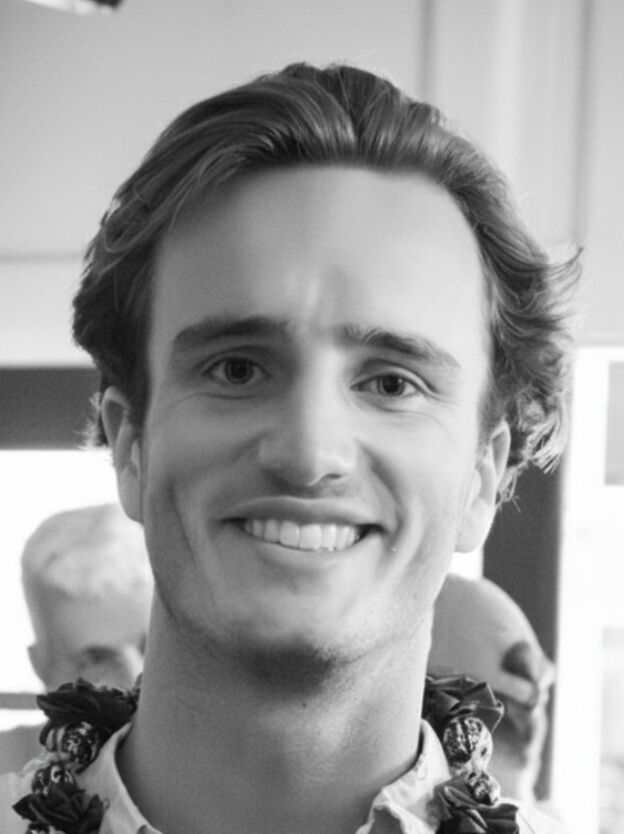

**Demographics:** male, 26 (born 1999), hetero, SF. Founder at YC AI startup (insert meme here).

**Fun Facts and Flexes**

- I like to run barefoot. If you see me in GGP give me a high five!
- I love foraging for wild plants. In college I was frequently caught eating wild greens growing
  outside the lecture halls.
- I’m obsessed with Astral Codex Ten (see my
  [favorite authors](https://robbiethompson.substack.com/p/my-favorite-books-and-authors)).
- I occasionally write on Substack, though I don’t claim it’s any good (favorite post
  [here](https://robbiethompson.substack.com/p/autistic-friendship)).
- I meditate a fair amount - I’ve done two ten-day silent retreats. Occasionally I faint while doing
  breathwork.
- I have four sisters :)
- I love teaching - in college I TAed five different classes and was a frosh RA.
- My first job out of college was trading bonds at Jane Street. I am prone to nerding out about
  math, AI, and finance.
- I occasionally freedive - I’ve been down 80 feet and held my breath for four minutes.
- Sometimes I teach yoga.

**Things I’m Attracted To (I think these all describe me too, maybe that makes me narcissistic
oops)**

_Eccentricity, Confidence_: *P*eople think you’re weird and wrong about topics you’ve thought hard
about. You stick out in crowds, and this doesn’t bother you.

_Embodiment_: You dance, meditate, sing, smell plants you pass on the street, jump in cold bodies of
water, close your eyes to eat, enjoy physical touch.

_Intelligence_: I learn new things from you. Ideally you like math/science/engineering

_Altruism_: You treat strangers as friends as yourself.

**Relationship Values**

_High trust:_ I will assume that you mean well, are telling the truth, and have my best interests at
heart until I see overwhelming evidence to the contrary. I have no interest in keeping score on who
pays the most or does the most chores or emotional labor.

_Directness:_ If you’re weighing whether to be polite or to be frank, I usually prefer the latter.
You can tell me an outfit is ugly even if I didn’t ask. We all want to be both kind and honest all
the time, but I’m not smooth enough to achieve that. I will be forthcoming, occasionally at the
expense of tact.

_Independence_: I am charismatic and extrovert-presenting, but by nature am an introvert and value
my alone time. If me going off the grid for ten days for a meditation retreat once every year or two
would be extremely burdensome for you, we might not be a great match.[^1]

**Your Potential Dealbreakers**

_Polyamory:_ I am poly

_Kids:_ I want kids and I’m excited about having them sooner rather than later

_Politics:_ Vaguely libertarian, don’t follow closely

_Religion_: I’m atheist; this isn’t important to me

**On a first date we could:**

- Have a picnic on the beach
- Play laser tag or go to
  [Activate SF](https://playactivate.com/san-francisco-stonestown?gad_campaignid=23323744690&gad_source=1&gbraid=0AAAABBS1yY3dGc_4EF6fmGlcIEX3c6Xlx&gclid=CjwKCAiAjojLBhAlEiwAcjhrDk2R-5Q3_AnaEPya406mY6nw01Gl8aLrhjrg0ENN7_AQU0lc1R8mMhoC6G4QAvD_BwE)
- Read and discuss each other’s favorite essays
- Go for a hike or jog
- Have a home-cooked meal at one of our apartments

**Contact info:** (650) 474 9283.
[robbiethompson2018@gmail.com](mailto:robbiethompson2018@gmail.com). I have no socials. Bonus points
if you reach out with a date me doc of your own!
[Some pics I use on the apps](https://drive.google.com/drive/folders/1geDuB0jjfGtrvQkfV77PB9QqnUipBGKW)

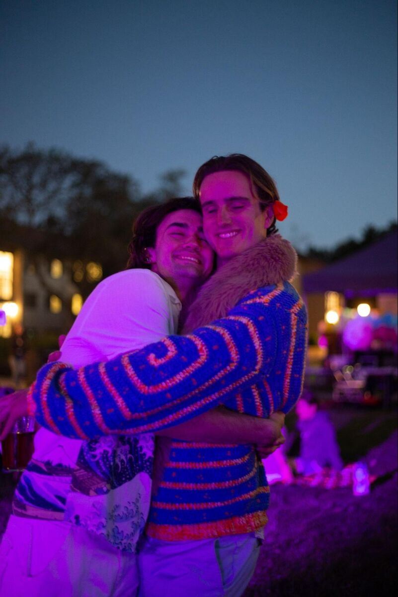
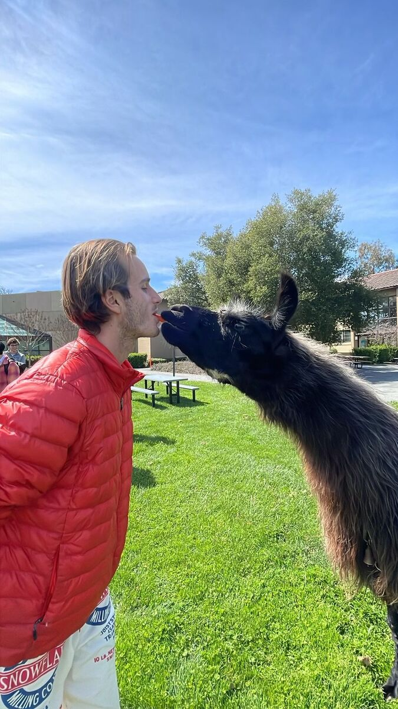
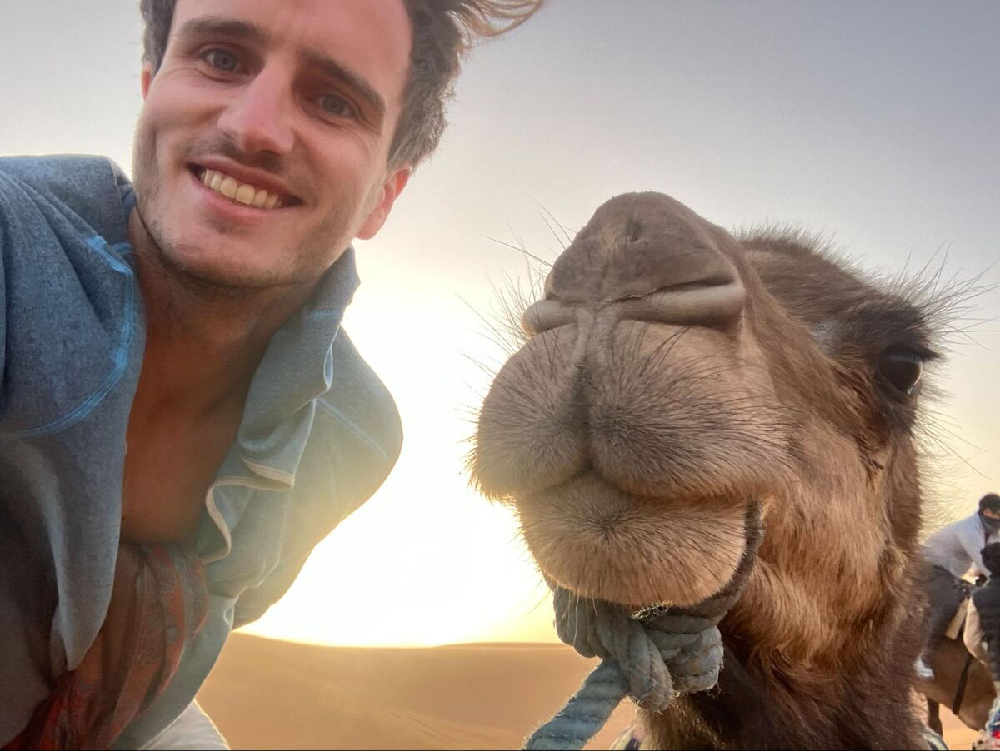

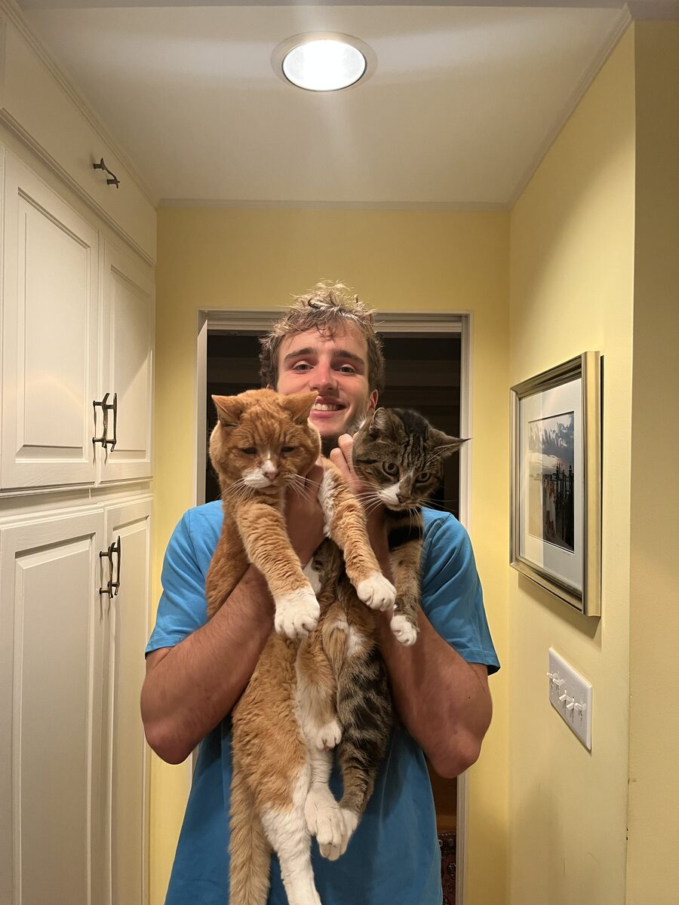
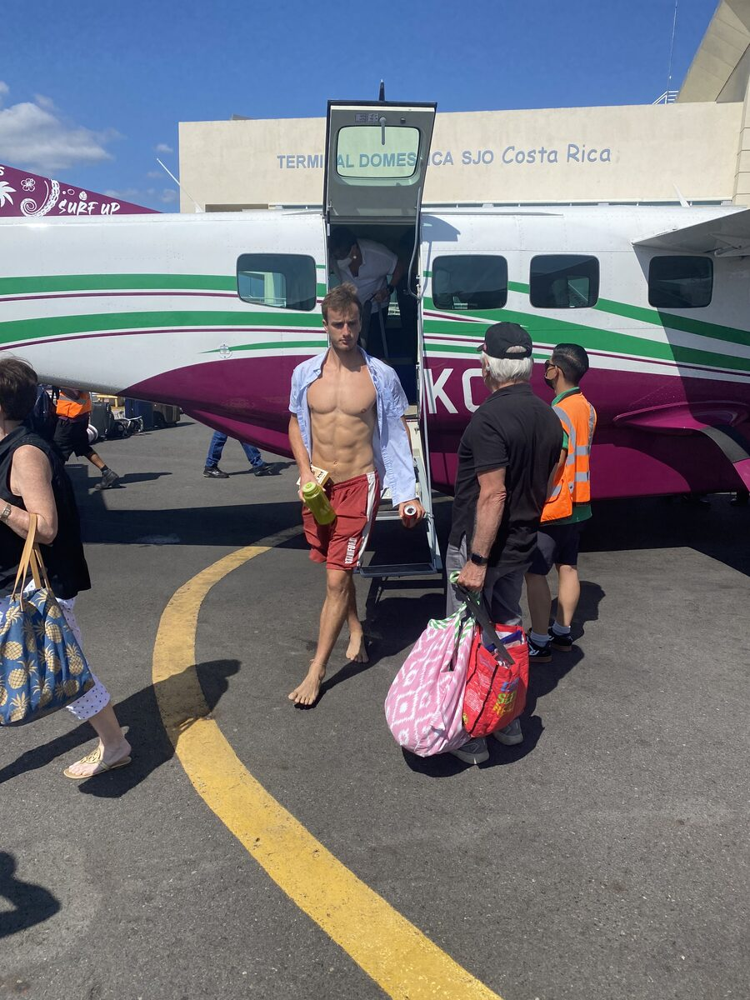
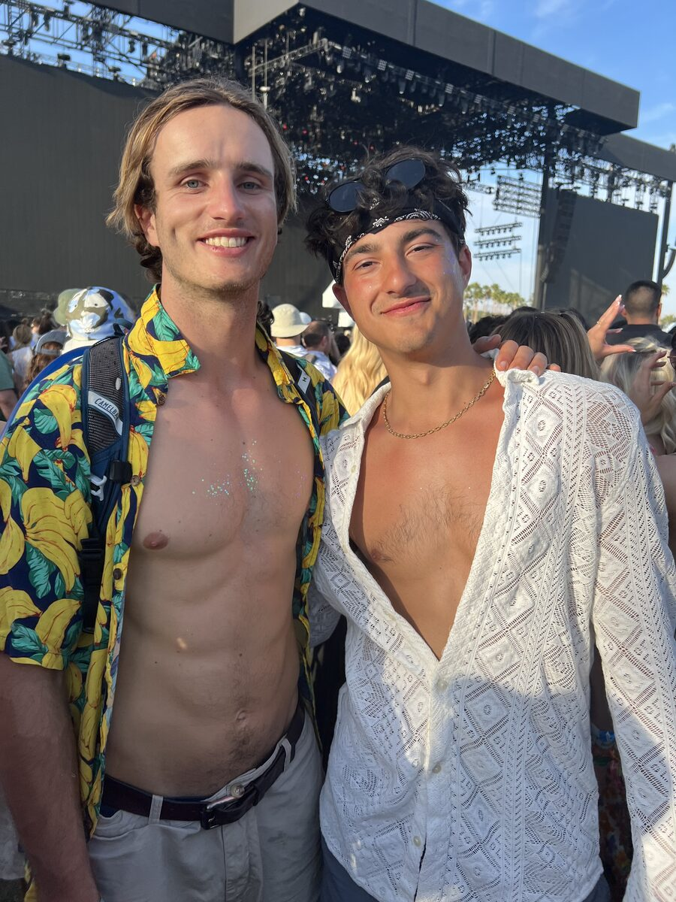

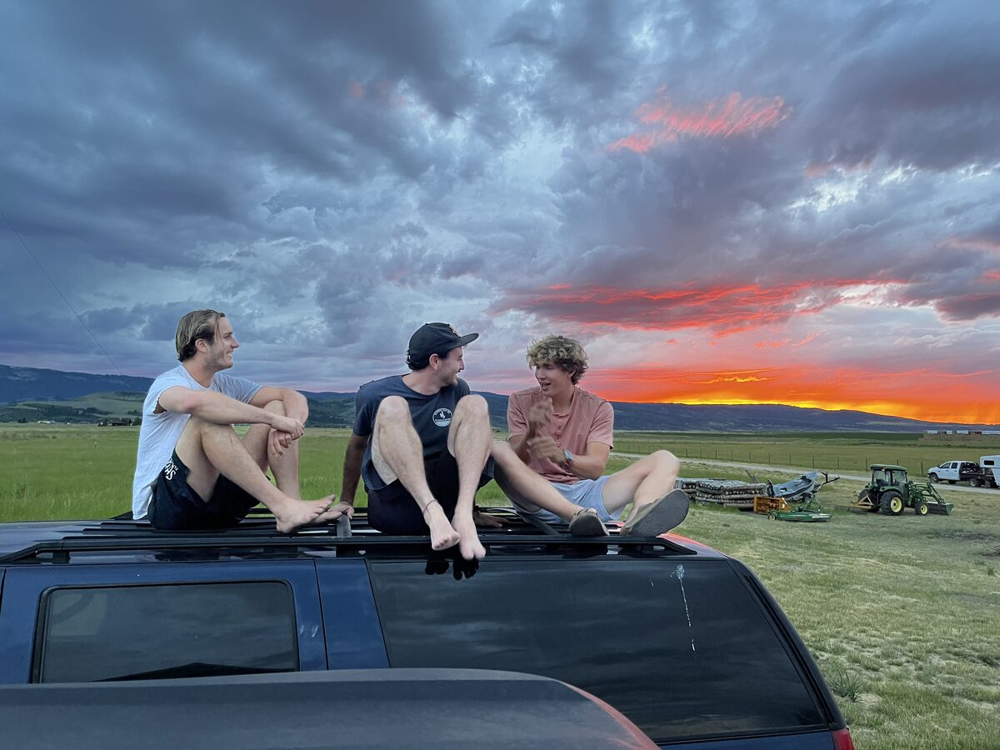
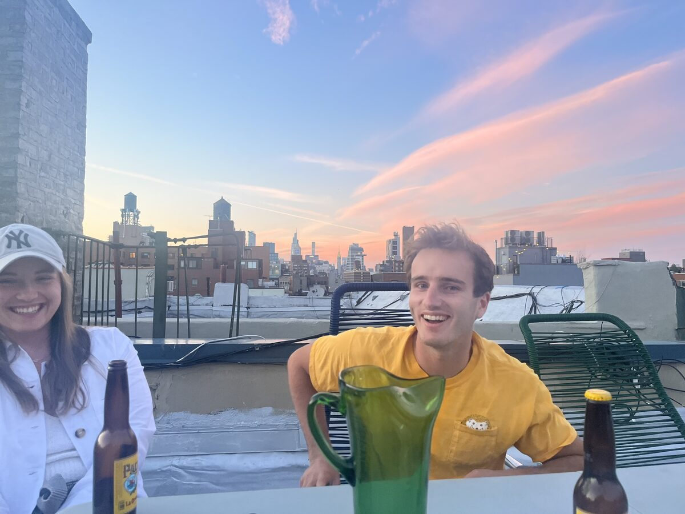

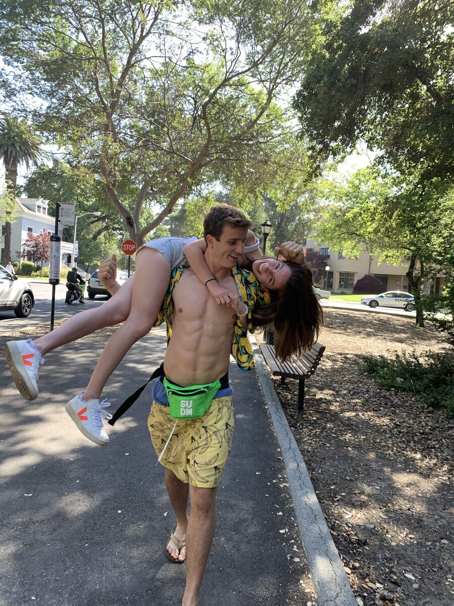
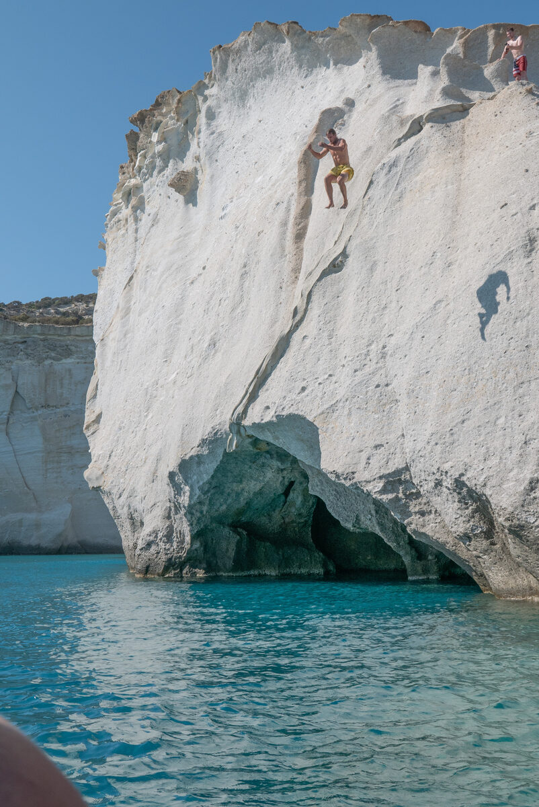

[^1]:
    To be explicit: I want an intimate and securely attached relationship, and I’m excited to
    support my partner when they need it. But I am attracted to people who can be happy alone.
