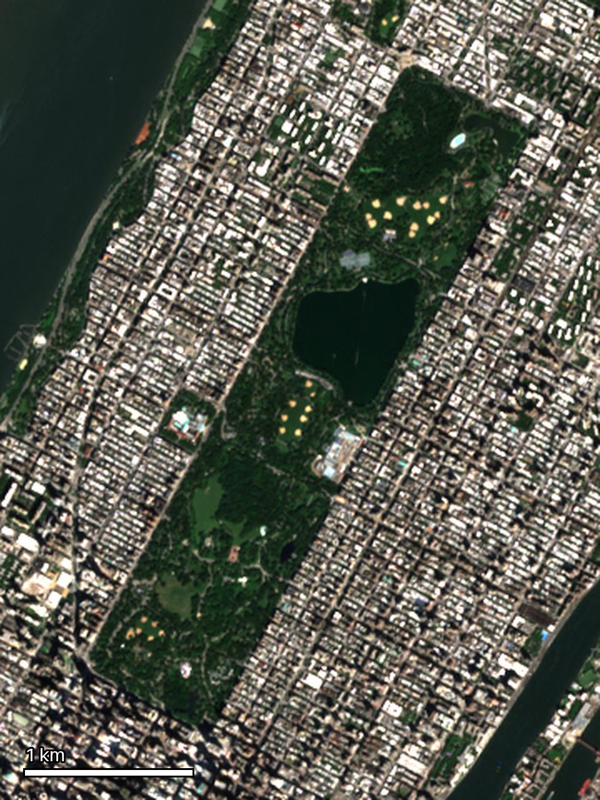
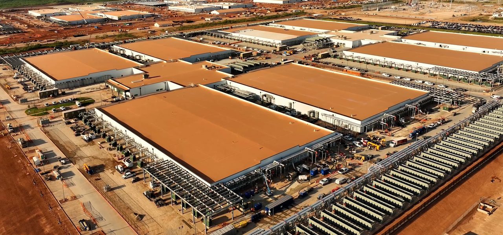
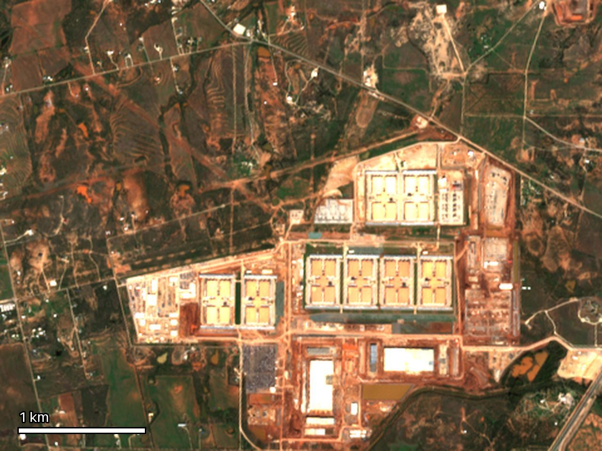
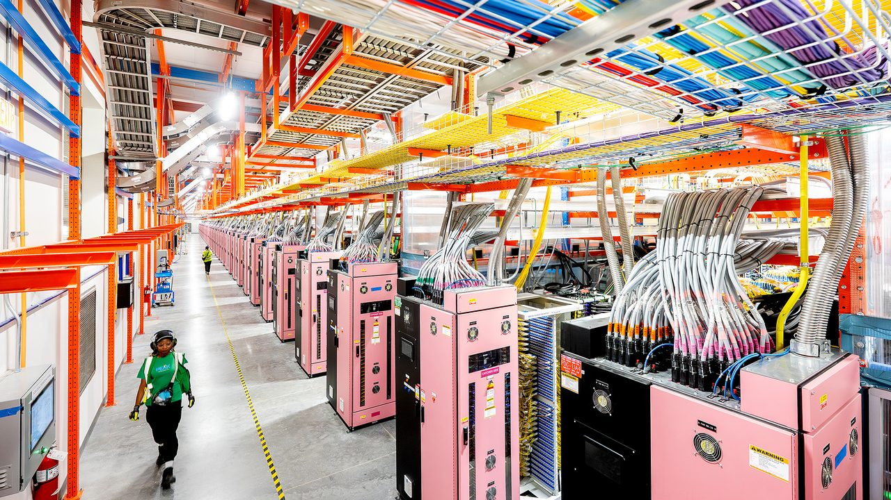
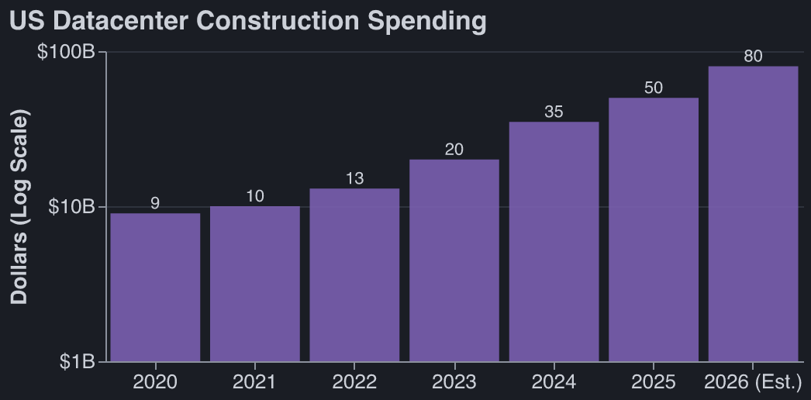

In 2024 Leopold Aschenbrenner wrote [Situational Awareness](https://situational-awareness.ai/). He
made the sci-fi prediction that in 2030 the AI labs would build a "trillion-dollar cluster." We're
not on track, but the datacenters are big.

---

Anthropic's biggest cluster [costs \$15B](@cost-newcarlisle). It's Project Rainier, in New Carlisle,
Indiana.

<figure><figcaption>AWS campus</figcaption></figure>
<figure><figcaption>Town of New Carlisle, same scale</figcaption></figure>
<figure><figcaption>Manhattan, same scale</figcaption></figure>

- [4,000 people](@nyt-rainier) constructed the site and [900 work there](@measuredai) permanently
- Total of [89 acres](@acres-newcarlisle) of indoor floor space
- Houses [$1.6 \times 10^{21}$ flops](@flops-newcarlisle), or 1.6 zettaflops (fp8). This is
  [as many flops as the entire world had as of 2015](@world2015)
- The cluster is [~30% of Anthropic's total compute](@anthropic-share)
- The site uses [1.2 billion watts](@power-newcarlisle) of power

The story is largely the same in Abilene:

- [6,400 workers](@oracle-factsheet)
- [92 acres](@crusoe-impact) of indoor space
- Houses [$2 \times 10^{21}$ flops](@flops-abilene), or 2 zettaflops (fp8)
- The cluster is [~20% of OpenAI's total compute](@openai-share)
- The site uses [1.2 billion watts](@crusoe-impact) of power

<figure><figcaption>Stargate campus</figcaption></figure>
<figure><figcaption>Downtown Abilene, same scale</figcaption></figure>
<figure><figcaption>Manhattan, same scale</figcaption></figure>

---

New Carlisle is an AWS datacenter.[^awsant] Notably, this means the site uses Trainium chips. My
semi-professional opinion is that compute is fairly fungible these days: inference can run almost
anywhere and most training is secretly inference via RL. The one thing you might not want to do at
New Carlisle is a large pretraining run, which depends on [at least 100k GPUs](@meta-100k) having
very high-bandwidth connections to one another. I will not get into too many technical details here,
but suffice it to say that one would prefer to do a frontier pretrain on TPUs or Nvidia GPUs over
Trainiums. I speculate with low confidence that Anthropic pretrains at New Carlisle and finds a way
to make Trainiums work, or pretrains at a Google Cloud datacenter on TPUs.

[^awsant]:
    Anthropic agreed to spend [at least \$110B on AWS services](@anthropic-aws) through 2036. The
    entirety of the New Carlisle site's [capacity is used by Anthropic](@cnbc-rainier). It's unclear
    what rights Anthropic has under their deal with AWS.

---

Abilene, meanwhile, houses almost entirely Nvidia GPUs ([B200s and B300s](@epochabilene)), which one
can use for almost anything.

The ownership structure of the site is a mess:

- Lancium (an energy startup, [worth \$10 billion](@lancium)) owns the land.
- Crusoe is the lead developer and landlord. They construct buildings, including
  [a 360 MW gas plant](@gasplant) for additional power capacity.
- Oracle buys the chips and builds the interior of the datacenter (the networking, cooling, etc.)

OpenAI didn't have good enough credit to own chips outright, which is why other firms, especially
Oracle, own the chips themselves.

---

<figure><figcaption>Interior of the New Carlisle site</figcaption></figure>

A datacenter is much more than just GPUs.

- [Hundreds of thousands of miles](@nyt-rainier) of fiber-optic cable, enough to wrap around the
  world [at least ten times](@fortune-fiber).
- Abilene has [liquid cooling piped to every chip](@crusoe-cooling). AWS's Trainium chips are
  [air-cooled](@register-rainier) and don't require this.
- Security: MFA at entry points and a perimeter wall that
  [would stop a fully-loaded 18-wheeler](@truck) at Abilene.
- [Exabytes ($10^{18}$ bytes) of storage](@storage-site). For context, global storage capacity is
  [about $10^{22}$](@storage-world) bytes, making these sites single-digit bps of global capacity.

Abilene is [a town of 130,000](@abilene-pop), and the datacenter employs only
[6,400 construction workers](@oracle-factsheet) and [about 300 permanent staff](@abilene-jobs). All
of Taylor County has GDP [\$10 billion](@taylor-gdp), compared to
[\$12 billion in annual datacenter-related spend](@abilene-spend), of which maybe \$1 billion is
labor and construction costs which residents and local businesses collect.

Crusoe got [an 85% discount](@abilene-abatement) on property taxes
([from \$150 million down to \$22 million](@abilene-proptax)). In addition, Texas has a
[statewide exemption on sales taxes](@tx-salestax) for datacenters, saving Oracle \$1.4
billion.[^salestax]

[^salestax]:
    Fermi estimate. Texas waives its 6.25% state sales tax on equipment bought for a qualifying
    datacenter, and the saving goes to whoever buys the equipment. At Abilene that is mostly Oracle,
    which buys the servers and networking gear: about \$22 billion (the \$18 billion and \$4 billion
    bars in the chart above). 6.25% of \$22 billion is \$1.4 billion. Crusoe gets the same break on
    the cooling and electrical equipment it buys, worth about \$0.4 billion more. Local sales tax
    still applies. No public record confirms that the site is certified for the exemption, though it
    clears the thresholds for size, investment and jobs many times over.

**New Carlisle, Indiana**

New Carlisle is in St. Joseph County, with [annual GDP \$19.5 billion](@stjoe-gdp) compared to
datacenter spend of [\$5 billion a year](@newcarlisle-spend). The AWS campus employs
[900 people](@measuredai) of [270k county residents](@stjoe-pop).

In 2025 the town [voted 4-0](@wvpe-vote) against a new datacenter adjacent to the existing site. The
existing site [needs further state permits](@expansion-permits) before it can expand.

## On Track

If we naively extrapolate that the biggest datacenters in 2030 will be [10x bigger](@growth-2030)
than today, then they will:

- Employ [60,000 construction workers and 3,000 permanent staff](@extrapolation-2030)
- Use [2% of US electricity production](@extrapolation-2030)
- Cost [\$120 billion per year, 0.4% of US GDP](@extrapolation-2030)
- Hold [$5 \times 10^{22}$ flops of compute](@extrapolation-2030), enough to train
  [GPT-6 Astra](@astra-compute) once every day.

Those numbers really don't match what I'd qualitatively expect in the 'singularity.'

Possibly this is the update I should expect based on how the past few years have gone. This week an
AI solved the Riemann hypothesis, yet here I am typing with my fingers and thinking with an
unenhanced meat computer inside a home constructed in the 1950s. Life is crazy at high levels of
abstraction and utterly mundane in its concrete details.

---

Photo credits: the New Carlisle aerial and data hall photos are by
[Amazon](https://www.aboutamazon.com/news/aws/aws-project-rainier-ai-trainium-chips-compute-cluster),
and the Abilene aerials are by
[Crusoe](https://www.crusoe.ai/resources/newsroom/crusoe-announces-flagship-abilene-data-center-is-live)
and [OpenAI](https://openai.com/index/five-new-stargate-sites/). The satellite images contain
modified Copernicus Sentinel data 2026.

{@cost-newcarlisle}: Estimate: Amazon announced \$11 billion in 2024, for a campus then planned at
16 buildings (Indiana Economic Development Corporation, 2024). The county's compliance review found
\$8.9 billion invested by January 1, 2026 (Measured AI, 2026), when 11 of today's 18 buildings were
running (Epoch AI, 2026): \$8.9 billion × 18 ÷ 11 = \$15 billion. The New Carlisle bars in the
spending chart, estimated part by part, also add up to about \$15 billion.
<https://measuredai.substack.com/p/aws-new-carlisle-data-center-campus>
<https://epoch.ai/data/ai-data-centers/directory/anthropic-amazon-new-carlisle>
<https://www.iedc.in.gov/events/news/details/2024/04/25/gov.-holcomb-announces-amazon-web-services-plans-to-invest-11b-to-create-a-new-data-center-campus-in-northern-indiana>

{@nyt-rainier}: New York Times (2025), "At Amazon's biggest data centre, everything is supersized
for AI", read via The Nightly's syndicated copy: "On a typical week, about 4,000 workers are on
site", and the complex will have "hundreds of thousands of miles of fibre connecting every chip and
computer together".
<https://thenightly.com.au/business/the-new-york-times-at-amazons-biggest-data-centre-everything-is-supersized-for-ai-c-19309860>

{@measuredai}: Corey Trinetti, Measured AI (2026), "AWS New Carlisle Data Center Campus: Project
Rainier - Where Anthropic Trains Claude": at the county's compliance review in June 2026, "AWS
reported 935 permanent on-campus jobs to date".
<https://measuredai.substack.com/p/aws-new-carlisle-data-center-campus>

{@acres-newcarlisle}: Estimate: 18 operating buildings × 216,000 square feet each = 3.89 million
square feet, which is 89 acres at 43,560 square feet per acre. The building size is from Corey
Trinetti, Measured AI (2026), "nine data center buildings, each about 35 feet tall and 216,000
square feet in size", and is published only for the nine northern buildings.
<https://measuredai.substack.com/p/aws-new-carlisle-data-center-campus>

{@flops-newcarlisle}: Estimate: Epoch AI, Frontier Data Centers hub, "Anthropic-Amazon New Carlisle"
(2026): "It hosts an estimated 818k H100-equivalents of AI compute", which the page gives as 1.62 ×
10²¹ 8-bit operations per second. Epoch's arithmetic: 16 buildings × 65,311 Trainium2 chips × 1.3 ×
10¹⁵ operations per second each, plus 2 buildings × 52,033 Trainium3 chips × 2.52 × 10¹⁵.
<https://epoch.ai/data/ai-data-centers/directory/anthropic-amazon-new-carlisle>

{@world2015}: Estimate: AI Impacts (2016), "Global computing capacity", put all the world's
computing hardware at about 2 × 10²⁰ to 1.5 × 10²¹ FLOPS around the end of 2015. Epoch AI's 1.6 ×
10²¹ for New Carlisle is at the top of that range. The comparison is loose: the 2015 figure counts
general-purpose arithmetic at higher precision, and the site's figure is a peak 8-bit rate.
<https://aiimpacts.org/global-computing-capacity/>

{@anthropic-share}: Estimate: New Carlisle's 1,037 MW of IT power (Epoch AI, 2026) ÷ the "more than
3.5 gigawatts of computing capacity" Anthropic expects online by the end of 2026 (Crypto Briefing,
published 2026) = 30%. By compute the share is 28%: 818k of the 2,966k H100-equivalents at every
Epoch-listed site tied to Anthropic. Neither company publishes a share.
<https://epoch.ai/data/ai-data-centers/directory/anthropic-amazon-new-carlisle>
<https://cryptobriefing.com/anthropic-3-5-gw-compute-capacity-2026/>

{@power-newcarlisle}: Epoch AI, Frontier Data Centers hub, "Anthropic-Amazon New Carlisle" (2026):
an estimated "1,037 MW of IT power", which Epoch's calculation sheet turns into 1,244 MW for the
whole facility at a power usage effectiveness of 1.2.
<https://epoch.ai/data/ai-data-centers/directory/anthropic-amazon-new-carlisle>

{@oracle-factsheet}: Oracle (2025), "Oracle Fact Sheet: Stargate Data Centers", posted by Rep. Jodey
Arrington's office: "There are more than 6,400 construction workers on site every day".
<https://arrington.house.gov/UploadedFiles/FINAL_Oracle_OAI_Data_Center_Fact_Sheet_092225b.pdf>

{@crusoe-impact}: Crusoe (2025), 2024 Impact Report, p. 19: "Upon completion in 2026, the campus
will house eight buildings covering 4 million square feet", which is 92 acres at 43,560 square feet
per acre, and "The data center campus will support AI workloads with 1.2 GW of power capacity".
<https://cdn.prod.website-files.com/6855c1aa175582ee23e0aa19/68710273a71bb7c11049ba28_Crusoe_Impact_Report_2024.pdf>

{@flops-abilene}: Estimate: Epoch AI, Frontier Data Centers hub, "OpenAI Stargate Abilene" (2026):
"It hosts an estimated 1,019k H100-equivalents of AI compute", which the page gives as 2.02 × 10²¹
8-bit operations per second. Epoch's arithmetic: 403,200 GPUs × 5 × 10¹⁵ operations per second each.
<https://epoch.ai/data/ai-data-centers/directory/openai-stargate-abilene>

{@openai-share}: Estimate: Abilene's 1.2 GW ÷ the 5 to 6 GW that Epoch AI (2026), "Frontier labs
don't use most AI compute (yet)", says third parties forecast for OpenAI by the end of 2026 = 20% to
24%. Other ways of counting give 15% to 38%. OpenAI has published no total for 2026.
<https://epoch.ai/gradient-updates/frontier-labs-dont-use-most-ai-compute>

{@meta-100k}: Mark Zuckerberg on Meta's third-quarter 2024 earnings call (October 30, 2024), as
transcribed by Benzinga (2024): "We're training the Llama 4 models on a cluster that is bigger than
100,000 H100s". Also reported by Business Insider (2024). <https://benzinga.com/z/41643021>
<https://www.aol.com/mark-zuckerberg-flexes-metas-cluster-184110913.html>

{@anthropic-aws}: Anthropic (2026), "Anthropic and Amazon expand collaboration for up to 5 gigawatts
of new compute". Anthropic's own wording is "more than \$100 billion over the next ten years". The
\$110 billion figure, running from May 2026 to April 2036, is from Anthropic's S-1 as reported by
Tom's Hardware and CNBC, and is not on this page.
<https://www.anthropic.com/news/anthropic-amazon-compute>

{@cnbc-rainier}: CNBC (2025), "Amazon opens \$11 billion AI data center Project Rainier in Indiana":
"The complex was built exclusively to train and run models from Anthropic".
<https://www.cnbc.com/2025/10/29/amazon-opens-11-billion-ai-data-center-project-rainier-in-indiana.html>

{@epochabilene}: Epoch AI, Frontier Data Centers hub, "OpenAI Stargate Abilene" (2026): an estimated
100,800 GB200 and 302,400 GB300 GPUs across the eight buildings, about 1 million H100-equivalents.
<https://epoch.ai/data/ai-data-centers/directory/openai-stargate-abilene>

{@lancium}: Estimate: Dealroom (2026), "Nvidia to invest up to \$3B in Texas power developer
Lancium": "An initial \$2 billion buys roughly 20% of Lancium". \$2 billion ÷ 20% = \$10 billion.
The article reports the investment and does not itself state a valuation.
<https://dealroom.co/news/143983-nvidia-to-invest-up-to-3b-in-texas-power-developer-lancium/>

{@gasplant}: Epoch AI (2026), calculations sheet for Stargate Abilene: "Title V permit application
specifies 10 natural gas turbine generators, with a total of 5 _ 38 MW + 5 _ 34.1 MW = 360.5 MW
between them."
<https://docs.google.com/spreadsheets/d/1M5VPpNDGTPgssU1x3xQJKv33EIa7-wgpDIFM8uzpodQ/>

{@fortune-fiber}: Fortune (2025), on the September 2025 press tour of the Abilene site, when two of
its eight buildings were finished: crews had "laid down enough fiber optic cable to wrap the Earth
16 times."
<https://fortune.com/2025/09/23/openai-oracle-and-softbank-expand-stargate-with-five-new-ai-data-centers-staging-texas-media-spectacle-to-counter-critics/>

{@crusoe-cooling}: Crusoe (2025), "An inside look at the Abilene AI data center": "We are building
this project with closed-loop, non-evaporative liquid cooling systems". The Nvidia GB200 NVL72 racks
it houses are liquid-cooled.
<https://www.crusoe.ai/resources/blog/an-inside-look-at-the-abilene-ai-data-center>

{@register-rainier}: The Register (2025), "Amazon Project Rainier: AI supercomputer for Anthropic":
Trainium2's switchless design and lower compute density have "allowed AWS to get away with air
cooling". <https://www.theregister.com/2025/07/04/project_rainier_deep_dive/>

{@truck}: Crusoe CEO Chase Lochmiller, interviewed by Billy Perrigo in TIME (2025): the Abilene
perimeter is "secured in such a way that if you drove a fully loaded 18-wheeler into it," the site
would be undamaged. Read via AOL:
<https://www.aol.com/articles/crusoe-ceo-chase-lochmiller-building-181814209.html>

{@storage-site}: Estimate: neither site publishes a storage figure. Blocks & Files (2026), "Musk's
Colossus DC cluster – what's the storage situation?", reports that at Colossus 1 "230,000 GPUs
need >1 EB of capacity for training and checkpointing workloads", which is 4 to 5 terabytes per GPU.
At that ratio Abilene's 400,000 GPUs need about 2 exabytes.
<https://www.blocksandfiles.com/flash/2026/11/04/musks-colossus-dc-cluster-whats-the-storage-situation/5307253>

{@storage-world}: Wasabi (2022), "What Does It Take to Store Zettabytes of Data?", citing IDC: the
world's installed storage capacity "reached 7.9 zettabytes (ZB) in 2021" and was forecast to grow
about 19% a year through 2025. A zettabyte is 10²¹ bytes.
<https://wasabi.com/blog/data-management/cloud-object-storage-zettabytes>

{@abilene-pop}: Census Reporter (2024), Abilene, TX profile, from the Census Bureau's American
Community Survey 2024 1-year estimates: population 130,033.
<https://censusreporter.org/profiles/16000US4801000-abilene-tx/>

{@abilene-jobs}: Texas Standard (2026) reports about 300 permanent jobs at the Abilene site once it
is running. The tax abatement requires 357 full-time jobs (Business Insider, 2025).
<https://texasstandard.org/stories/stargate-data-center-abilene-texas-construction-ai-artificial-intelligence/>

{@taylor-gdp}: U.S. Bureau of Economic Analysis via FRED (2026), series GDPALL48441: Taylor County's
GDP was \$9.87 billion in 2024. <https://fred.stlouisfed.org/data/GDPALL48441.txt>

{@abilene-spend}: Estimate: Epoch AI (2026) puts the campus "at a capital cost of \$31.2 B".
Construction began in June 2024 (Crusoe, 2025), so that is about 2.5 years of building: \$31.2
billion ÷ 2.5 = \$12 billion a year.
<https://epoch.ai/data/ai-data-centers/directory/openai-stargate-abilene>
<https://www.crusoe.ai/resources/newsroom/crusoe-announces-flagship-abilene-data-center-is-live>

{@abilene-abatement}: KTAB/KRBC via Yahoo News (2025), "Abilene City Council weighs large tax
abatement for Lancium", quoting City Manager Robert Hanna: "On the tax abatement side, it's 15% of
their tax liability. So, we're abating 85%, and we get 15%."
<https://www.yahoo.com/news/abilene-city-council-weighs-large-005212844.html>

{@abilene-proptax}: Estimate: the Development Corporation of Abilene (2025), in an award application
to the Texas Economic Development Council, projects that "the City of Abilene will receive an
estimated \$22.6 million in property tax revenue each year for 20 years". That is the 15% left after
the abatement, so the full city bill is \$22.6 million ÷ 0.15 = \$151 million a year.
<https://texasedc.org/assets/main/awards/CEDA2025/abilene-2025-ceda.pdf>

{@tx-salestax}: Texas Tribune (2026), "Texas losing a billion dollars a year on data center tax
break": "Qualifying data centers are exempted from paying the state’s 6.25% sales taxes on purchases
related to building and maintaining the facility".
<https://www.texastribune.org/2026/04/08/texas-data-centers-sales-tax-break-billion-dollars/>

{@stjoe-gdp}: U.S. Bureau of Economic Analysis via FRED (2026), series GDPALL18141: St. Joseph
County's GDP was \$19.49 billion in 2024. <https://fred.stlouisfed.org/data/GDPALL18141.txt>

{@newcarlisle-spend}: Estimate: about \$15 billion for the 18 buildings now running ÷ about three
years of building = \$5 billion a year. The \$15 billion scales up what the county's compliance
review found: Corey Trinetti, Measured AI (2026), reports that "\$8.9 billion of the \$11 billion
had been invested as of January 1, 2026", when 11 of the 18 buildings were running. Amazon announced
the \$11 billion in April 2024 (Indiana Economic Development Corporation, 2024).
<https://www.iedc.in.gov/events/news/details/2024/04/25/gov.-holcomb-announces-amazon-web-services-plans-to-invest-11b-to-create-a-new-data-center-campus-in-northern-indiana>
<https://measuredai.substack.com/p/aws-new-carlisle-data-center-campus>

{@stjoe-pop}: USAFacts (2026), from the Census Bureau's population estimates: "In 2025, there were
about 272,900 people living in St. Joseph County, IN."
<https://usafacts.org/answers/how-many-people-live-in-the-us/county/st-joseph-county-in/>

{@wvpe-vote}: WVPE (2025), "New Carlisle council opposes second data center nearby": "The New
Carlisle Town Council voted 4-0 Tuesday for a resolution opposing a developer's request to rezone
over 1,000 acres of farmland near New Carlisle for a data center."
<https://www.wvpe.org/wvpe-news/2025-10-24/new-carlisle-council-opposes-second-data-center-nearby>

{@expansion-permits}: Corey Trinetti, Measured AI (2026), "AWS New Carlisle Data Center Campus:
Project Rainier - Where Anthropic Trains Claude": the 14-building expansion has two pending state
permits, an air permit applied for in May 2026 and a wetlands permit applied for in June 2026, with
"decisions likely by early 2027".
<https://measuredai.substack.com/p/aws-new-carlisle-data-center-campus>

{@growth-2030}: Estimate: three ways to get the factor. Trend: Epoch AI (2025), "Trends in AI
Supercomputers", measured the power needs of leading AI supercomputers doubling every year, which
compounds to 16x over the four years to 2030; the same paper projects a 9 GW system for mid-2030,
7.5x today's 1.2 GW. Announced sites: the largest, OpenAI's in Ohio, is planned to reach 8 GW in
2032 (OpenAI, 2026), about 4x by 2030. Aschenbrenner's table (2024) goes from about 1 GW in 2026 to
about 100 GW in 2030, 100x. 10x is a round number between the announced sites and the trend.
<https://epoch.ai/blog/trends-in-ai-supercomputers>
<https://openai.com/index/openai-joins-ports-pike-project/>
<https://situational-awareness.ai/racing-to-the-trillion-dollar-cluster/>

{@extrapolation-2030}: Estimate: today's Abilene site times ten. Workers: 6,400 in construction and
about 300 permanent, times ten. Power: 12 GW against an average of 516 GW of US generation in 2025
(4,523 TWh, EIA, 2026) is 2%. Cost: \$31 billion times ten is \$310 billion, spread over 2.5 years
of building as at Abilene is \$120 billion a year, against 2025 US GDP of \$30.9 trillion (BEA via
FRED, 2026). Compute: 2 × 10²¹ times ten for the power, times 2.4 for four years of chips getting
25% more efficient a year (the gap between the 2.5x-a-year performance growth and 2x-a-year power
growth Epoch AI measured).
<https://www.eia.gov/energyexplained/electricity/electricity-in-the-us-generation-capacity-and-sales.php>
<https://fred.stlouisfed.org/data/GDPA.txt> <https://epoch.ai/blog/trends-in-ai-supercomputers>

{@astra-compute}: Estimate: Epoch AI's estimate of GPT-6 Astra's training run is about 9.4 × 10²⁶
FLOP (at least 100,000 GB200 chips for about 90 days at 25% utilization), as relayed by FutureSearch
(2026) and not checked against Epoch's own page. A site with 5 × 10²² flops at the same 25%
utilization does that much in about 21 hours. The whole Abilene site today would take about 22 days.
<https://futuresearch.ai/app/p/a/rsi-largest-training-compute?idx=0>
