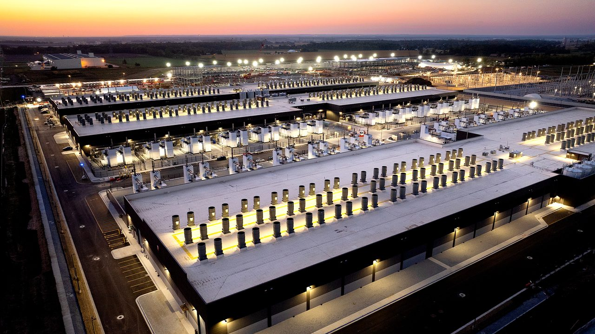
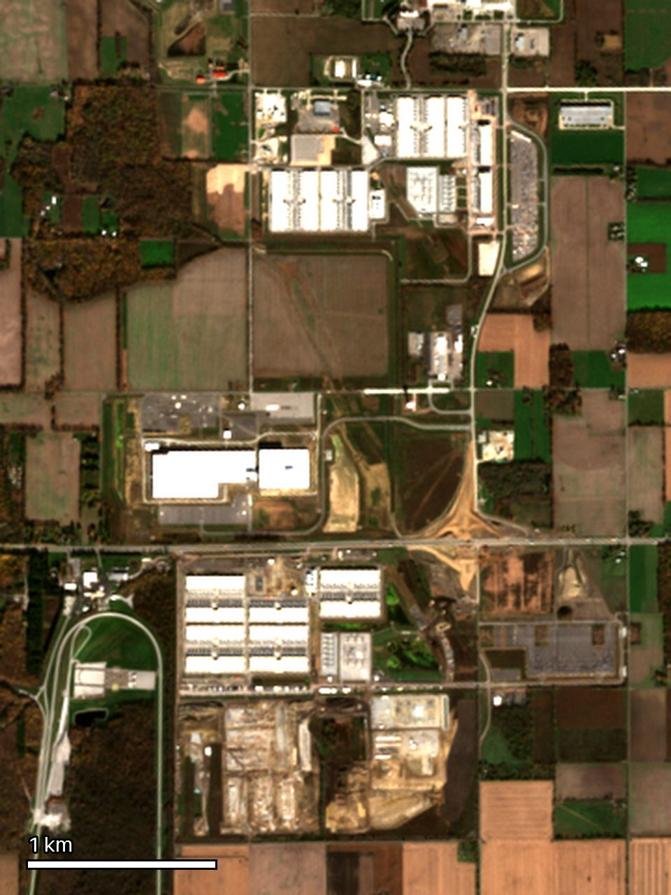
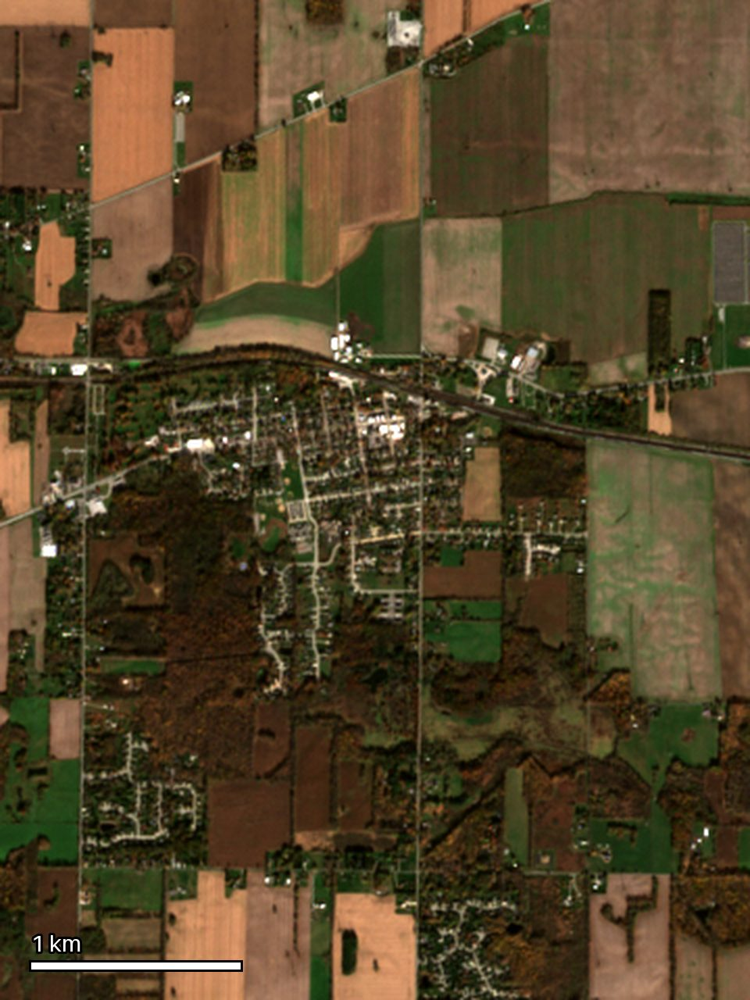
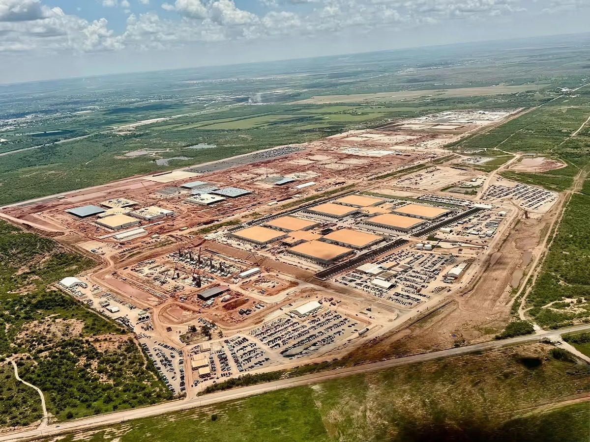
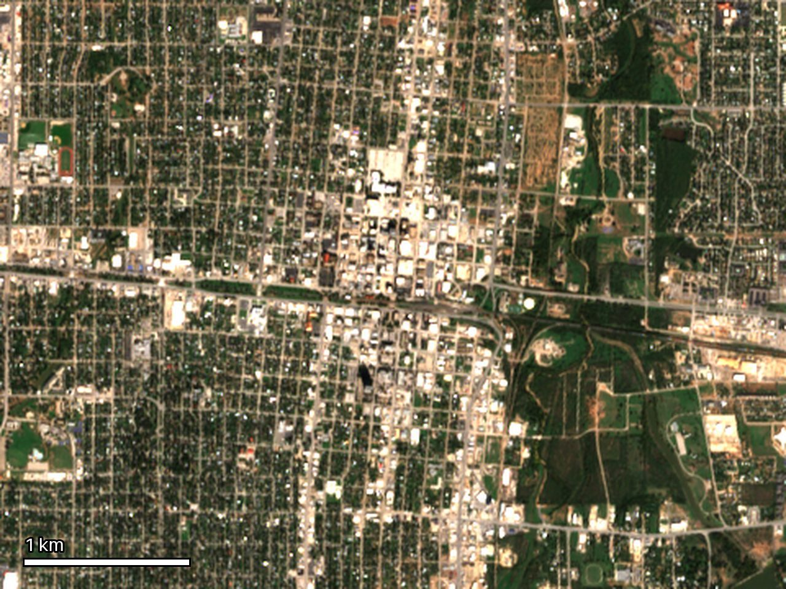
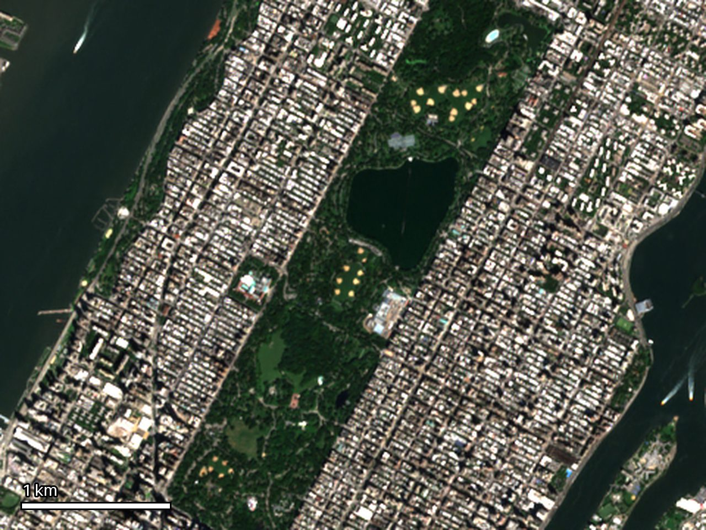
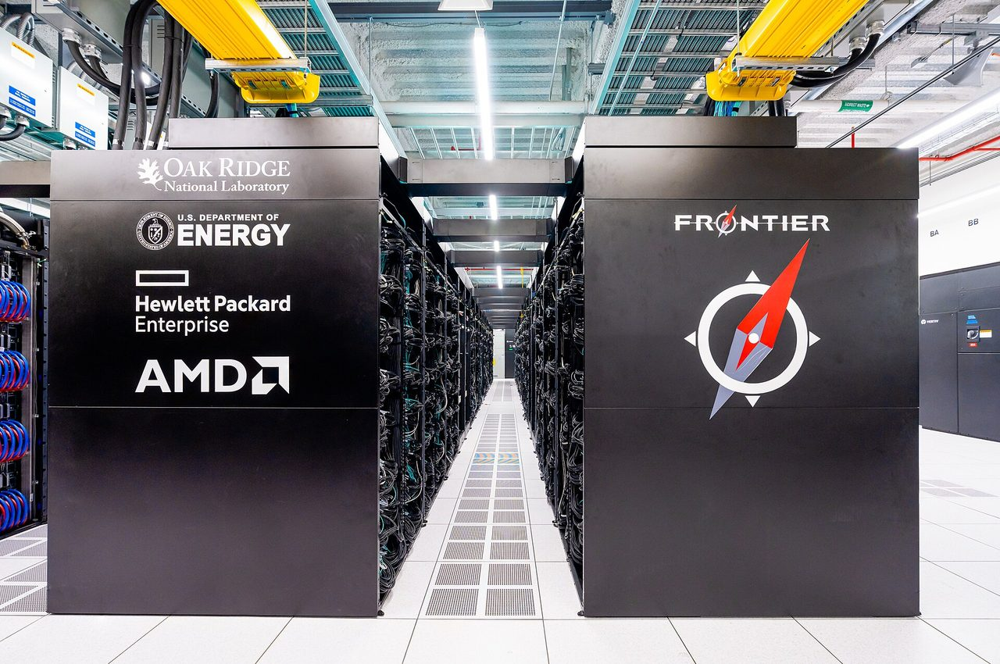

In 2024 Leopold Aschenbrenner wrote [Situational Awareness](https://situational-awareness.ai/). He
made the sci-fi prediction that in 2030 the AI labs would build a "trillion-dollar cluster." We're
on track.

---

Anthropic's biggest cluster costs \$11B. It's Project Rainier, in New Carlisle, Indiana.

<!-- @robbie done: New Carlisle same-scale row with the town and Manhattan. Imagery: Sentinel-2 true colour, 10 m per pixel, every frame 3.6 km wide by 4.8 km tall (portrait, because the two AWS clusters span about 4.5 km north to south) at 3.75 m per displayed pixel, the same as the Abilene row, with a 1 km scale bar. Campus and town are one scene taken 2026-11-10, https://earth-search.aws.element84.com/v1/collections/sentinel-2-l2a/items/S2C_16TEM_20261110_0_L2A. Manhattan is centred on Central Park (4 km long), taken 2026-08-29, https://earth-search.aws.element84.com/v1/collections/sentinel-2-l2a/items/S2B_18TWL_20260829_0_L2A. In the campus frame the single big building between the two AWS clusters is the GM/Samsung battery plant. Credit: Contains modified Copernicus Sentinel data 2026. Licence: Copernicus Sentinel data licence, free and open, attribution required. -->

<figure><figcaption>AWS campus</figcaption></figure>
<figure><figcaption>Town of New Carlisle, same scale</figcaption></figure>
<figure><figcaption>Manhattan, same scale</figcaption></figure>

- 4,000 people work at the site.
- Total of 89 acres of indoor floor space.
- Houses 1.6e21 flops, or 1.6 zettaflops (fp8). This is as many flops as the entire world had as
  of 2015.
- The cluster is ~30% of Anthropic's total compute.
- The site uses 1.2 billion watts of power.

<!-- @robbie done: this chart is merged with the cost chart you asked for further down, under "A datacenter is much more than just GPUs". It has these five categories (chips, new power capacity, buildings, land, annual power spend) plus networking and storage, for both sites. To show it here, move or copy the cost_bars.png image line up to this spot. -->

The story is largely the same in Abilene:

- 6,400 workers
- 92 acres of indoor space
- Houses 2e21 flops, or 2 zettaflops (fp8). This is as many flops as the entire world had as
  of 2015.
- The cluster is ~20% of OpenAI's total compute.
- The site uses 1.2 billion watts of power.

<figure><figcaption>Stargate campus</figcaption></figure>
<figure><figcaption>Downtown Abilene, same scale</figcaption></figure>
<figure><figcaption>Manhattan, same scale</figcaption></figure>

---

New Carlisle is an AWS datacenter.[^awsant] Notably, this means the site uses Trainium chips. My
semi-professional opinion is that compute is fairly fungible these days: inference can run almost
anywhere and most training is secretly inference via RL. The one thing you wouldn't want to do at
New Carlisle is a large pretraining run, which depends on hundreds of thousands of GPUs having very
high-bandwidth connections to one another. I will not get into too many technical details here, but
suffice it to say that one would prefer to do a frontier pretrain on TPUs or Nvidia GPUs over
Trainiums. I speculate with low confidence that Anthropic pretrains at New Carlisle and finds a way
to make Trainiums work, or pretrains at a Google Cloud datacenter on TPUs.

[^awsant]:
    Anthropic agreed to spend at least \$110B on AWS services through 2036. The entirety of the New
    Carlisle site's capacity is used by Anthropic. It's unclear what rights Anthropic has under
    their deal with AWS.

---

Abilene, meanwhile, houses almost entirely Nvidia GPUs ([B200s and B300s](@epochabilene)), which one
can use for almost anything.

The ownership structure of the site is a mess:

- Lancium (an energy startup, worth \$10 billion) owns the land.
- Crusoe is the lead developer and landlord. They construct buildings, including a 360 MW gas plant
  for additional power capacity.
- Oracle buys the chips and builds the interior of the datacenter (eg the networking, cooling, etc.)

OpenAI didn't have good enough credit to own the land or chips outright, which is why other firms,
especially Oracle, own the chips themselves.

---

A datacenter is much more than just GPUs.

<!-- @robbie done: what else is in a datacenter, answers below. Full notes: POST_RESEARCH.md -->

- Hundreds of thousands of miles of fiber-optic cable, enough to wrap around the world tens of
  times.
- Abilene has liquid cooling piped to every chip. AWS's Trainium chips do not require this; the
  datacenter is air-cooled.
- Security: MFA had entry points and a perimeter all that
  [would stop a fully-loaded 18-wheeler](@truck) at Abilene.
- Exabytes (10^18 bytes) of storage. For context, global storage capacity is about 10^22 bytes,
  making these sites tens of bps of global capacity.

<!-- @robbie done: the cost chart above is now linear scale, axis in billions of dollars. The small categories are slivers but keep their value labels. -->

Abilene is a town of 130,000, of which the datacenter employs only 6,000. The rest of Taylor County
has GDP \$10 billion, compared to \$12 billion in annual datacenter-related spend.

Crusoe did manage to get a tremendously good deal on the taxes they owe: they got an 85% discount on
property taxes (from \$150 million down to \$22 million). In addition, Texas has a statewide
exemption on sales taxes for datacenters, saving Abilene \$1.4 billion.

<!-- @robbie done: placeholders filled in the two Abilene paragraphs above. Taylor County GDP: 9.87 billion dollars in 2024 (BEA via FRED). Annual datacenter spend, 12 billion: Epoch AI's 31 billion all-in estimate spread over about 2.5 years of building (June 2024 to late 2026), Claude's arithmetic; the Development Corporation of Abilene's "more than 47 billion" would make it 19 billion a year. Property tax, 150 million: the city's projected 22.6 million a year is 15% of the bill, so the full bill is 22.6 / 0.15 (the 22.6 is the Development Corporation of Abilene's 2025 projection). Sales tax: the Texas exemption is the 6.25% state sales tax on equipment; 1.4 billion is 6.25% of about 22 billion of servers and networking, Claude's arithmetic, no published figure for this site. CHECK: "employs only 6,000" is the construction workforce; permanent jobs are 357 required by the tax contract. -->

<!-- @robbie done: placeholders filled in the New Carlisle paragraph below (you said to in chat). 900 is permanent staff; the 4 billion a year is the 11 billion announced spread over about three years. St. Joseph County GDP: 19.5 billion dollars in 2024 (BEA via FRED). Datacenter spend: 11 billion announced in total, of which 8.9 billion was reported spent, so about 3 to 4 billion a year since 2024. Jobs: 935 permanent (0.9 thousand) and about 4,000 in construction, against about 273,000 county residents. The 4-0 vote was the New Carlisle Town Council on October 21, 2025, and it was advisory; the county council then rejected the rezoning 7-2 in December 2025. The 14-building expansion needs a state wetlands certification and an air permit from Indiana's environmental agency, decisions expected early 2027. All in POST_RESEARCH.md, part "The Towns". -->

**New Carlisle, Indiana**

New Carlisle is in St. Joseph County, with annual GDP \$19.5 billion compared to datacenter spend of
\$4 billion a year. The AWS campus employs 900 people of 270k county residents.

In 2025 the town voted 4-0 against a new datacenter adjacent to the existing site. Expanding the
existing site is blocked on state permitting.

---

Photo credits: the New Carlisle aerial and data hall photos are by
[Amazon](https://www.aboutamazon.com/news/aws/aws-project-rainier-ai-trainium-chips-compute-cluster),
and the Abilene aerials are by
[Crusoe](https://www.crusoe.ai/resources/newsroom/crusoe-announces-flagship-abilene-data-center-is-live)
and [OpenAI](https://openai.com/index/five-new-stargate-sites/). The satellite images contain
modified Copernicus Sentinel data 2026. The supercomputer aisle is Frontier at Oak Ridge National
Laboratory, by
[OLCF at ORNL](<https://commons.wikimedia.org/wiki/File:Frontier_Supercomputer_(1).jpg>),
[CC BY 2.0](https://creativecommons.org/licenses/by/2.0/).

{@epochabilene}: Epoch AI, Frontier Data Centers hub, "OpenAI Stargate Abilene" (2026): an estimated
100,800 GB200 and 302,400 GB300 GPUs across the eight buildings, about 1 million H100-equivalents.
<https://epoch.ai/data/ai-data-centers/directory/openai-stargate-abilene>

{@truck}: Crusoe CEO Chase Lochmiller, interviewed by Billy Perrigo in TIME (2025): the Abilene
perimeter is "secured in such a way that if you drove a fully loaded 18-wheeler into it," the site
would be undamaged. Read via AOL:
<https://www.aol.com/articles/crusoe-ceo-chase-lochmiller-building-181814209.html>
