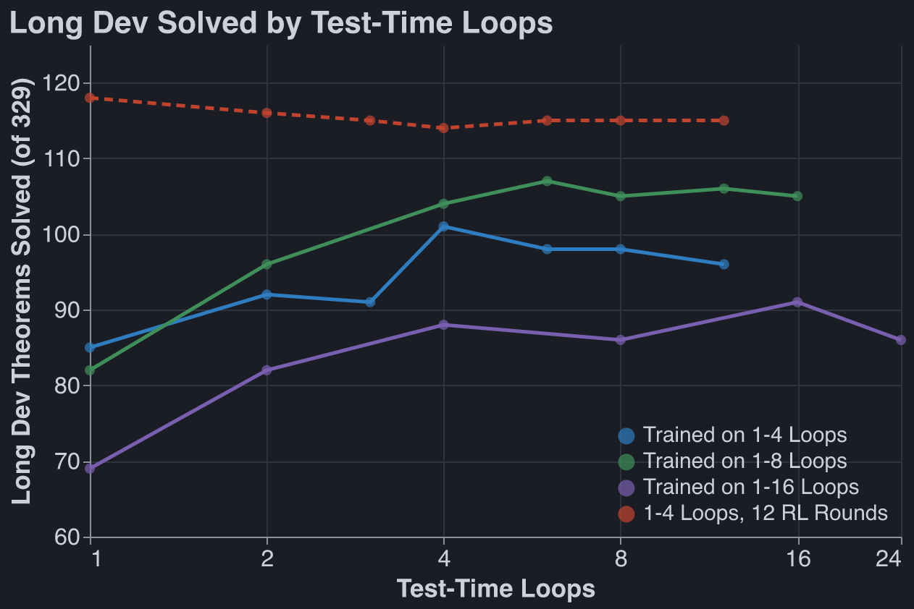
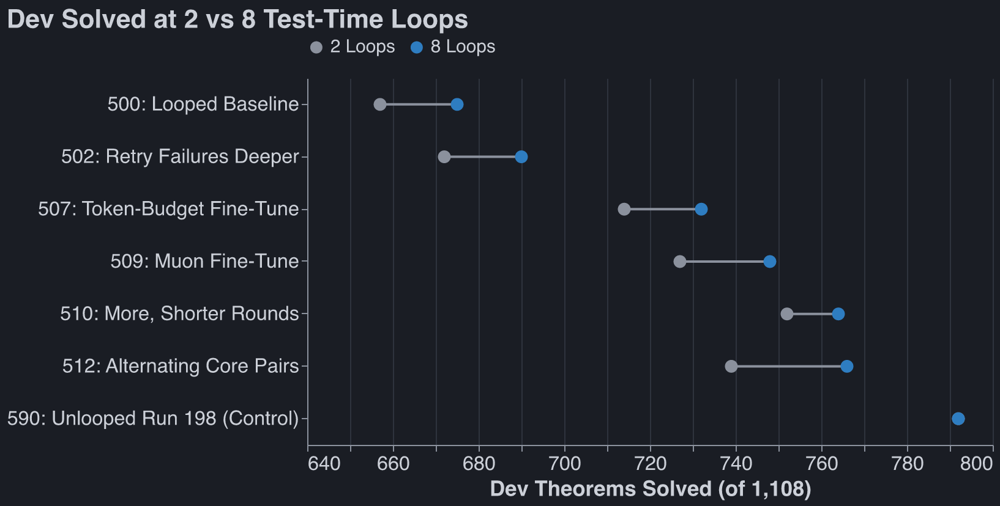
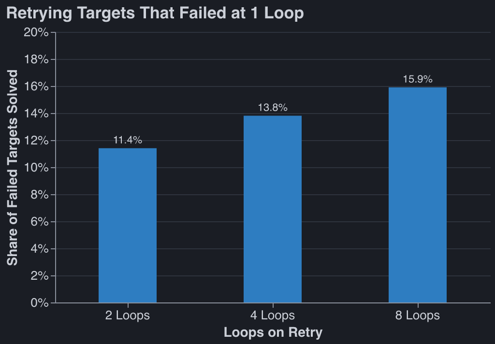
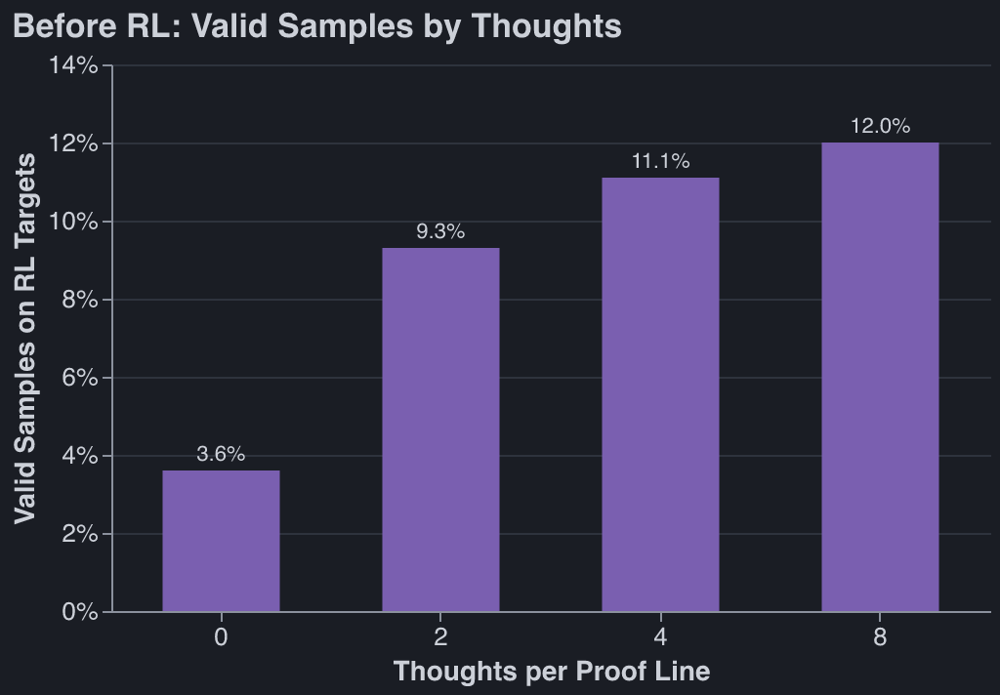
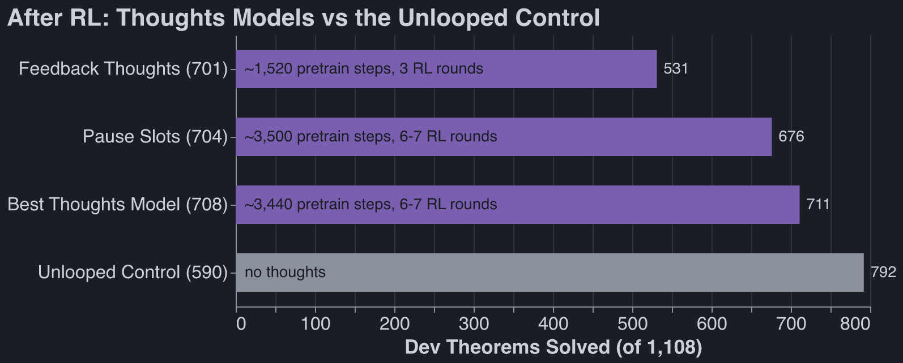
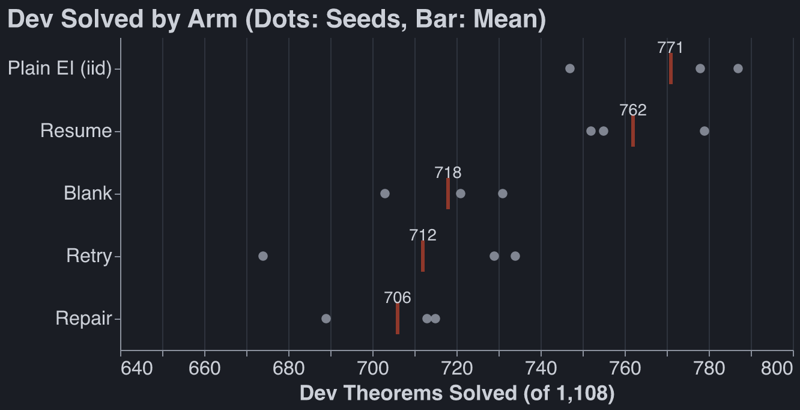
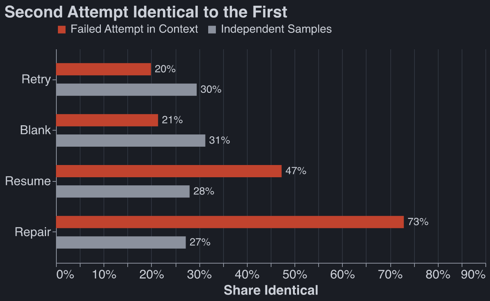
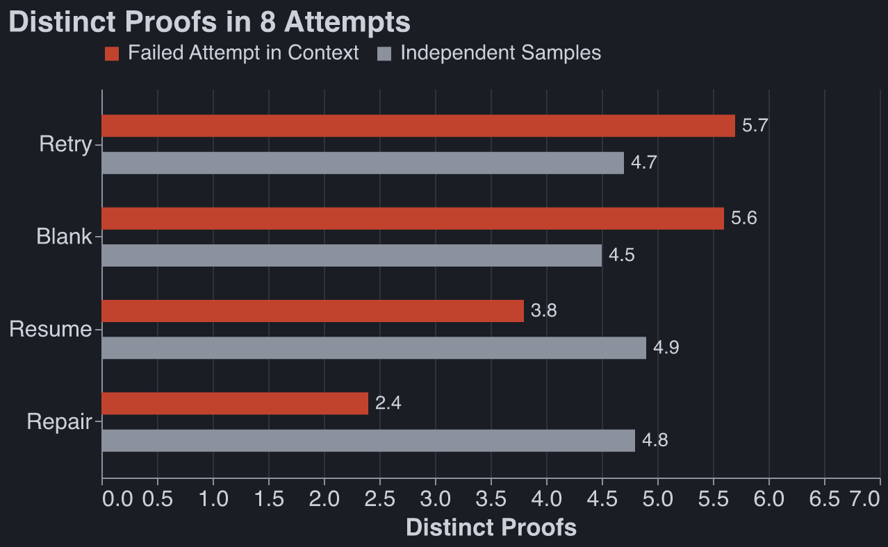

_Epistemic status: largely written by Claude_

Work done October 5–11.

My goal for the week was to find some regime in which test-time scaling works convincingly. Thinking
more improves performance in recurrent models. Looping more improves performance (somewhat) on a
given looped transformer. Nothing beats vanilla transformers.

## Looped transformers don't scale with test-time loops

- Eight loops beat two by 2–4% on dev, at 3× the sampling compute. Cannot productively use more
  loops than they were trained on, even if we randomize loop number during training.
- More RL erases most of the benefit. After 12 RL rounds, 1 loop did as well as 4.
- At equal RL, the unlooped model wins: 792 vs 766 dev theorems.
- One clean positive result: of the targets that failed 8 tries at 1 loop, retries at 2/4/8 loops
  solved 11.4% / 13.8% / 15.9%.

## Continuous thoughts (Coconut-style) don't win either

- Before RL, thinking clearly helps: valid samples on the RL targets go from about 4% with no
  thoughts to 12% with 8 thoughts per line.
- After RL, the benefit is all in the step from 0 to 2 thoughts.
- Speed decided the score. Recipes that pass gradient through the thoughts get about 1,550
  pretraining steps and 3 RL rounds; pause slots get about 3,500 steps and 6–7 rounds, but the model
  ignores the thoughts.
- Best result 711, against the plain 792 control.

## Retrying with Lean errors: the model doesn't use its failed proofs

First, definitions:

- _Resume_: Resample as soon as you get a Lean error (so if you started down a bad path, you're
  stuck).
- _Retry_: The model sees its failure plus a Lean error token (one of 32).
- _Blank_: Same as retry, except we always emit the same `<fail>` token on Lean errors.
- _Repair_: Retry, but add synthetic recoveries.

* Every variant scored below plain EI (706–762 vs 771).
* On the _retry_ leg, the model ignores the failure. Trained to _repair_, it copies the failure (73%
  of second attempts identical to the first).
* Why: failures are mostly _wrong plans_, and the Lean error points to where type-checking stopped,
  not to the earlier choice that made the proof unfinishable.
* Keeping the error-free prefix commits the model to the bad plan, so starting over beats resuming.
* Side effect: with failures in context, 8 attempts produce 5.7 distinct proofs vs 4.7 for
  independent samples, worth about 4 theorems.

