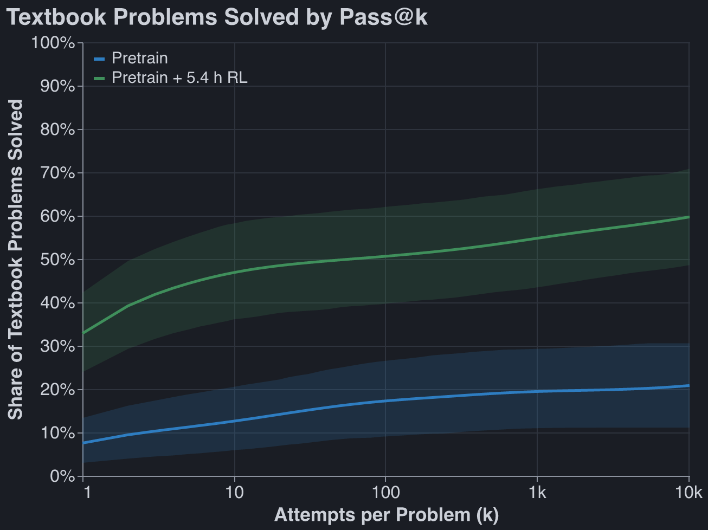
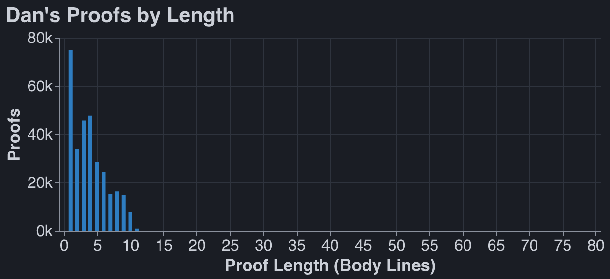
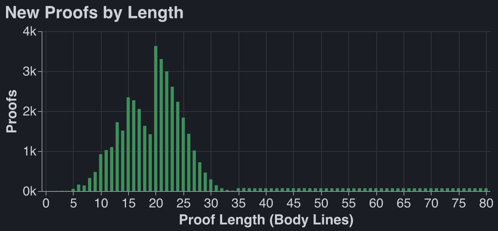
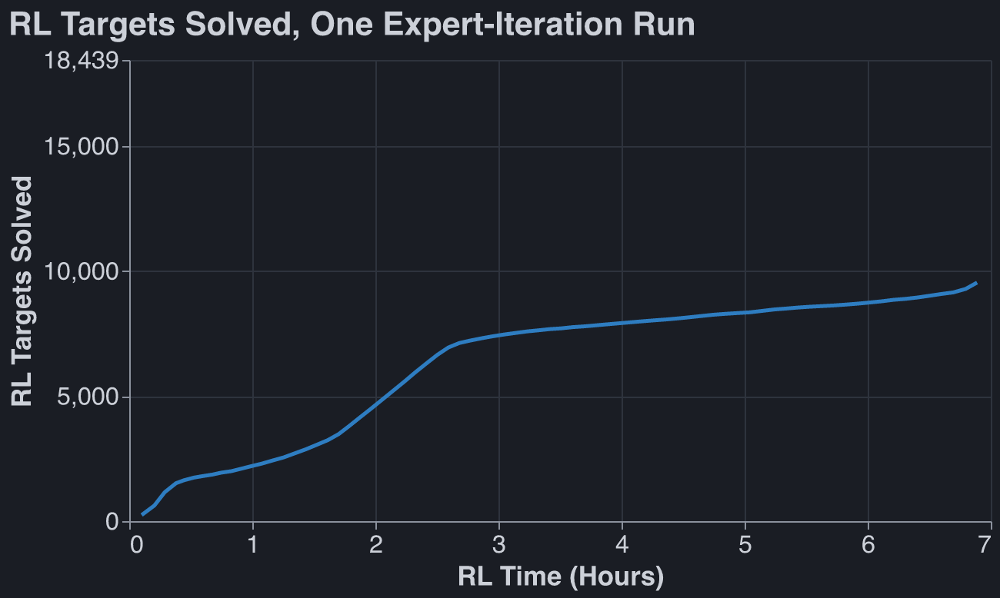
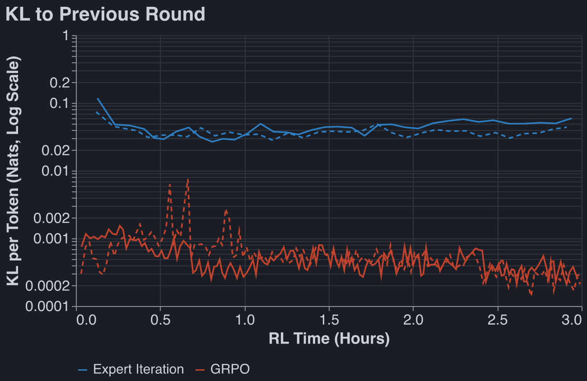
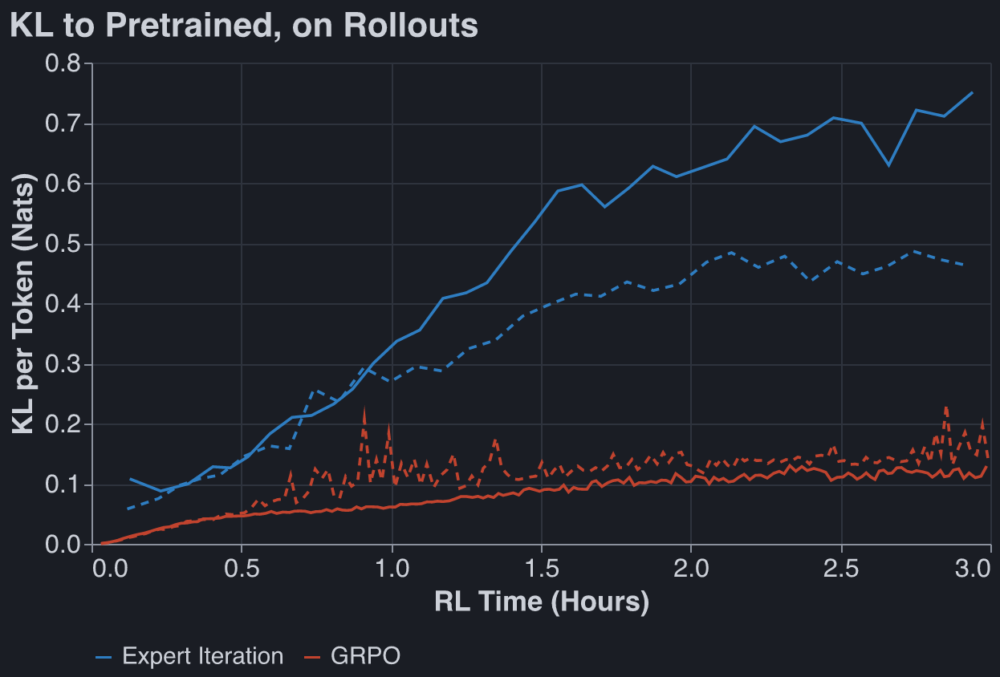
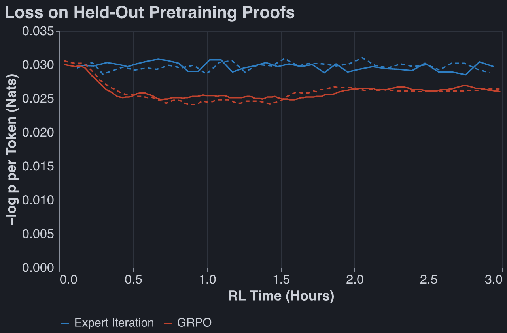
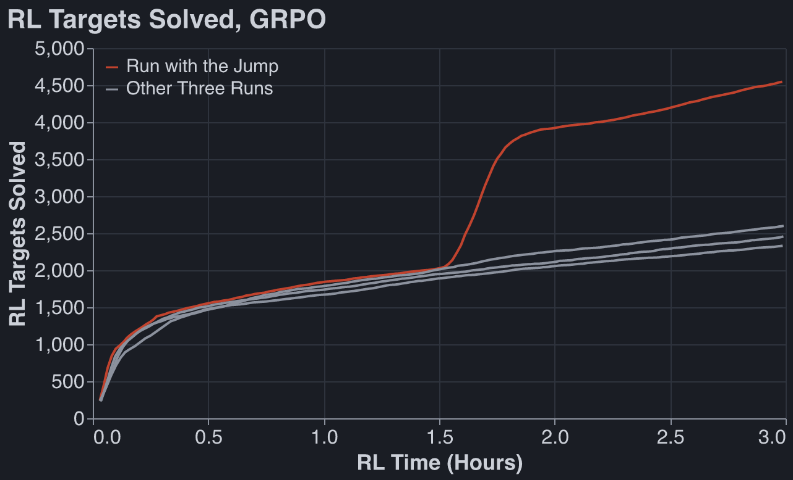

Work done October 12-18.

## Our current RL paradigm is robustly 'emergence' and not 'distillation'

I was quite confident in this for some time, but others were not convinced, so here is a graph of
our best RLed model's performance on a held-out set of textbook problems, relative to its pretrain:

Between $k = 100$ and $k = 10{,}000$, the base model solves 2.6 new problems (3.6%) and the RLed
model solves 6.5 new problems (9.1%).

## More Data

I created a dataset of 41,205 new proofs.

Generators write theorems with deliberately deep proofs using 3–10 premises. A C rewrite of Dan's
exhaustive minimal-length search, about 15,000× faster, then certifies each theorem's exact minimal
length, or that no proof shorter than 20 body lines exists, and every proof is checked in Lean.

With this dataset, expert iteration does not saturate after six hours of training. Previously we
saturated within an hour: the old setup had solved 83% of its RL targets after 10 minutes. This also
improved my previous best on the 72 heldout textbook problems, from 32 to 36 solved (pass@256).

## Why is GRPO so much worse than EI?

The GRPO recipe I evaluated seems to barely update model weights at all between rounds. It does not
include a KL penalty. Low KL divergence each round is downstream of a 10x lower learning rate than
EI. I leave it to Leon to improve this recipe (update: he did, GRPO now beats EI, on his data at
least).

### GRPO Gets Box of Depth Three

One thing GRPO struggles to learn, which EI learns quickly, is making proofs of depth 3. Broadly
this was caused by GRPO's low learning rate. Concretely, GRPOed models tried to close two boxes at
once, and thus fail to learn proofs which require closing several boxes in a row. GRPOed models do
learn some proofs of depth 3 very quickly, just like EI does. Mysteriously, one GRPO run did break
through this wall, leading to this graph:

EI learns to generate proofs up to depth 5.
