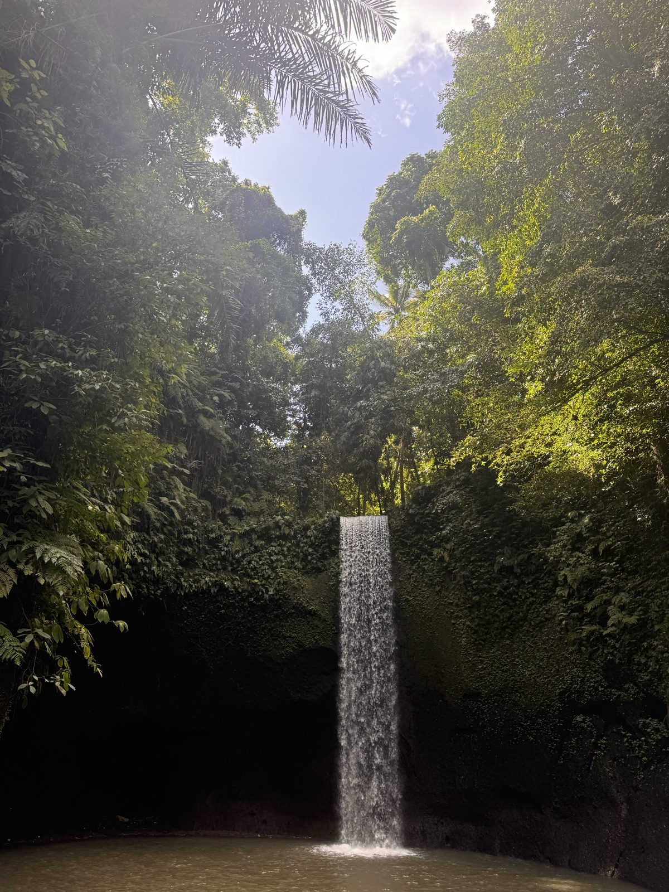

Epistemic Status: Fictional

In the Redwood grove just north of the de Young, there are three hundred-foot Redwoods with
auto-belays nailed to the trunk sixty feet up. One is a 5.4 with climbable branches the whole way,
another a 5.10a with brown footholds discreetly nailed into the bark, and the third a 5.12a on which
you have to hand-jam in cracks in the bark.

On Sundays there's a water polo game in China Basin. A Croat and a Russian team had a bitter brawl
there last year, and the Russians moved their game to Blue Heron Lake inside Golden Gate Park.

Also in Blue Heron Lake: sailing lessons on El Toros, and in the summers a water slide down from
Strawberry Hill.

The apricot, persimmon, and pomegranate trees in the public orchard at what used to be Hunters Point
have begun bearing fruit. Schoolchildren bike over to glean fallen fruit. Every July the locals host
an apricot-preserving fair and share the jam with their neighbors.

The empty pavement by the basketball courts in SF's Panhandle just had a parkour gym installed, to
match exactly that seen in [World Chase Tag](https://www.worldchasetag.com/). On Tuesday nights the
line to play next lasts 30 minutes.

Waymo sponsored turning the Stonestown Galleria parking lot into an artificial nature preserve,
complete with a stonemasoned waterfall. The locals go cliff-jumping on weekends.

There's a via ferrata you can take to the top of Sutro Tower, which books out months in advance.

The city banned internal combustion engines and human-driven cars. Every resident has access to a
publicly run self-driving-car network.

Ever since banning ICEs, tule elk and deer began repopulating the tip of the peninsula. The deer
particularly enjoy the Spanish grass in meadows that were once parking lots.

Outside rush hour, kids play touch football and field hockey in the streets. There hasn't been a
traffic death in 20 years.

In twelve parking lots the city installed artificial springs, enjoyed by wildlife and humans alike.
Sutro Baths has been restored to its former glory, with capacity for 1000 bathers and 300
sauna-goers.

Salmon run again up Mission Creek every November. Kids fish with hook and line.

Most of the concrete in Golden Gate Park was ripped up and replaced with dirt trails. I'm no longer
the only barefoot runner in the park.

The Monterey Cypress at the top of Strawberry Hill has a treehouse on top. It's the best place in
the city to watch the sunset.

The state genetically modified the sunflower sea star and reintroduced it to the California coast.
Between them and the resurgent sea otter populations, purple sea urchins have been driven back down
to normal levels and the kelp forests have returned. Freedivers spearfish at Fort Point and cook
rockfish on the beach.

The California Coastal Redwood, which covered 2.2 million acres in 1500 and 113,000 acres in 2026,
again covers 580,000 acres in 2040.

The national light pollution laws of 2030 worked. You can see the Milky Way from anywhere in the
city.
