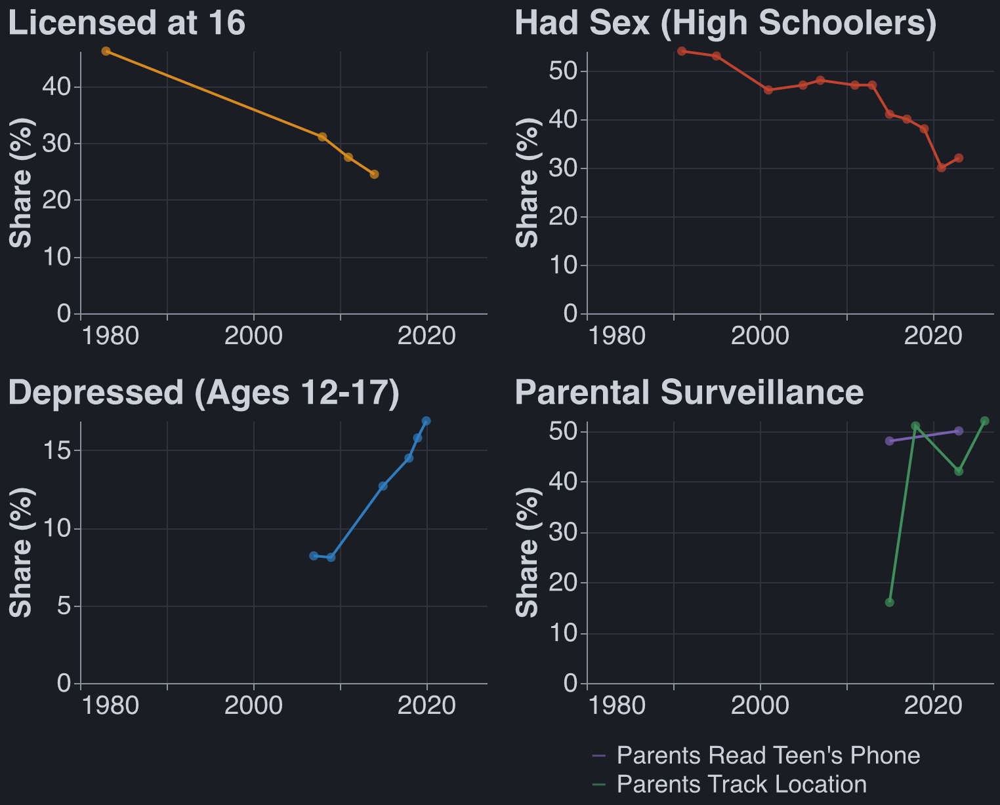

## TLDR

I weakly believe that powerful lie detection technology would be good for society. Technological
capability is not a bottleneck on governments exerting power.

## Enforcement Is Not Blocked on Capabilities

The US government could be scraping (public, warrant-not-required) Instagram for photos of people
smoking weed, tracking down said people, and arresting them. This does not happen. Notably, this
_does_ happen in the case of child pornography.[^almost] Most Western governments do not use all
means at their disposal to enforce their own laws, which massively weakens arguments against
technology on the basis of enabling 'oppressive governments.'[^donny]

[^almost]:
    Practically speaking, cloud hosting platforms do most of the work to keep child porn off of
    their services, but the intelligence apparatus comes after bad actors when this does not
    suffice. See eg [PlayPen](<https://en.wikipedia.org/wiki/Playpen_(website)>).

<!-- @robbie done (was "@c fix link"): now points at the Playpen Wikipedia page. -->

[^donny]:
    It is worth mentioning that the Trump administration _did_
    [use social media to gather evidence for deportations](https://en.wikipedia.org/wiki/Visa_and_deportation_controversies_in_the_second_Trump_administration)
    and it largely did not hold up in court, though cases are still being appealed.

To take the thought experiment further: if you could ban any law enforcement agency from using
digital evidence to catch or prosecute criminals, would you do it? Why is 'the exact technological
capacity USG has right now' the optimal amount? More technological capability and better
institutions (eg warrants) would be a Pareto improvement. More tech alone is better unless you have
very strong opinions on states wielding too much power in the present day, which is a seductive but
nonobvious position. Are you not happy that we catch child pornographers and murderers? Wouldn't it
be nice if we could do the same to corrupt politicians and insider traders?

Counterargument: surveillance has real cost which we might not know about. Courts dismiss grossly
miscollected evidence, but this tends not to matter; the NSA can and will use
[parallel construction](https://en.wikipedia.org/wiki/Parallel_construction), i.e. "we read his
email without a warrant, John Doe will be selling dope on First Street at 6pm, pull him over for his
tinted windows."

It's messy and mixed, but I am OK with increasing the capabilities of the US justice system. Notably
not analyzed: foreign governments.

## Idealized Lie Detector

Imagine a device which lets me "biologically sign" any statement. The signature only works if I
genuinely believe the statement to be true and not misleading. This device cannot be wielded against
me without my consent; I must actively sign a statement by, say, speaking the words intentionally.
(I am _not_ assuming that one could not be pressured into using the device, only that one could not
have arbitrary beliefs read from one's mind nonconsensually).

I doubt that the tech tree is shaped in such a way that we can have consensual lie detectors but not
nonconsensual ones. But I'm not sure, someone should look into it!

## The Glorious Transhumanist Future

Once a year I biosign a document online stating "I am not a terrorist, I love America and planes." I
get to the airport 20 minutes before takeoff and walk straight from the curb to the gate, no TSA in
sight.

Every politician biosigns the campaign platform on their website. Mysteriously, medicine falls to
10% of GDP, the Jones Act is repealed, and California finishes a train line.

Few politicians are able to biosign that they have never used illicit substances. Marijuana is
legalized federally.

Slowly but surely, the worst corporate misdeeds are eliminated by biosignature norms. Oil company
execs pledge to make reasonable efforts to eliminate bribery. Food and pharma company scientists
biosign that their papers are neither misleading nor cherrypicked. AI lab CEOs promise to pause
under certain conditions. None of these are 100% effective. All help.

## Appendix: Mommy States

After the state, I most fear giving lie detectors to parents.[^corporations]

[^corporations]: Maybe I should be more worried about companies?

Children having fun experiences in the real world is trending down across categories. It's unclear
whether the driver of this is technological surveillance.
[Half of parents have (ever) looked through their kid's phone.](@pew-phone) I am nervous that cheap
lie detectors would further empower oppressive household mommy-states.

{@pew-phone}: Pew Research Center (2024), "How Teens and Parents Approach Screen Time": half of
parents of 13-to-17-year-olds say they have looked through their teen's phone (surveyed
September–October 2023). In Pew's 2014–15 survey, 48% had looked through their teen's call records
or text messages.
<https://www.pewresearch.org/internet/2024/03/11/how-teens-and-parents-approach-screen-time/>

Sources: licences [Sivak & Schoettle 2016](@umtri); sex
[CDC 2012](@cdc-mmwr), [CDC 2024](@cdc-yrbs); depression [SAMHSA 2020](@nsduh); reading phones
[Pew 2016](@pew-monitor), [Pew 2024](@pew-phone); location tracking [Pew 2016](@pew-monitor),
[Burnell 2023](@burnell), [Pew 2024](@pew-adult), [Mott 2026](@mott). The location line mixes
populations: parents of 13–17s (2015), one US state (2018), parents of 18–25s (2023, 2026).

{@umtri}: Sivak & Schoettle (2016), University of Michigan Transportation Research Institute report
UMTRI-2016-4: share of each age group holding a driver's licence, from Federal Highway
Administration data. <https://public.websites.umich.edu/~umtriswt/PDF/UMTRI-2016-4.pdf>

{@cdc-mmwr}: CDC (2012), "Trends in HIV-Related Risk Behaviors Among High School Students — United
States, 1991–2011," _MMWR_: share of high schoolers who have ever had sexual intercourse, 1991–2011.
<https://www.cdc.gov/mmwr/preview/mmwrhtml/mm6129a4.htm>

{@cdc-yrbs}: CDC (2024), "Youth Risk Behavior Survey Data Summary & Trends Report: 2013–2023": the
same measure, 2013–2023. <https://www.cdc.gov/yrbs/dstr/pdf/YRBS-2023-Data-Summary-Trend-Report.pdf>

{@nsduh}: SAMHSA (2020), "Key Substance Use and Mental Health Indicators in the United States:
Results from the 2019 National Survey on Drug Use and Health," Figure 48: share of
12-to-17-year-olds with a major depressive episode in the past year, 2004–2019. The survey's method
changed in 2021, so later years aren't comparable and aren't plotted.
<https://www.samhsa.gov/data/sites/default/files/reports/rpt29393/2019NSDUHFFRPDFWHTML/2019NSDUHFFR1PDFW090120.pdf>

{@pew-monitor}: Pew Research Center (2016), "Parents, Teens and Digital Monitoring" (surveyed
2014–15): 48% of parents of 13-to-17-year-olds had looked through their teen's call records or
messages, and 16% tracked their teen's location.
<https://www.pewresearch.org/internet/2016/01/07/parents-teens-and-digital-monitoring/>

{@burnell}: Burnell, Andrade, Kwiatek & Hoyle (2023), _Journal of Family Psychology_: 51% of parents
of 12-to-18-year-olds in one US state tracked their child's location in 2018.
<https://pmc.ncbi.nlm.nih.gov/articles/PMC10238636/>

{@pew-adult}: Pew Research Center (2024), "Parents, Young Adult Children and the Transition to
Adulthood" (surveyed late 2023): 42% of parents of 18-to-24-year-olds track their child's location.
<https://www.pewresearch.org/social-trends/2024/01/25/parents-young-adult-children-and-the-transition-to-adulthood/>

{@mott}: C.S. Mott Children's Hospital National Poll on Children's Health (2026), "Safety or
surveillance: Tracking of young adults": 52% of parents of 18-to-25-year-olds track their child's
location. <https://mottpoll.org/reports/safety-or-surveillance-tracking-young-adults>

## Appendix: Prior Work

AI Futures Project tentatively in favor of lie detectors:
[AI 2040: Plan A](https://ai-2040.com/?choices=plan-a-root#should-lie-detectors-be-allowed-banned-or-regulated)
(July 2026)

LessWrong on the startup Conduit, I am surprised this post got so many upvotes and agree with
williawa's comment.
[Don't Build Mindreading](https://www.lesswrong.com/posts/CAdG5dzkWrrK2NQg8/don-t-build-mindreading)
(KellerScholl, August 2026)

David Friedman:
[If Lie Detectors Worked](https://daviddfriedman.substack.com/p/if-lie-detectors-worked) (July 2026)

Another LessWrong post which is mid:
[Lie detection is best when it's cheap to cooperate](https://www.lesswrong.com/posts/u7nEaWygHkvfDiwa2/lie-detection-is-best-when-it-s-cheap-to-cooperate)
(sciarrino, October 2026)

## Appendix: To Think About Further

This post comes from a fairly normie place, worrying about state power and not the looming
AI-pocalypse. I want to think further about

1. What I would ask AI company CEOs to biosign.

3. How bad it is to give mindreading to oppressive governments.
